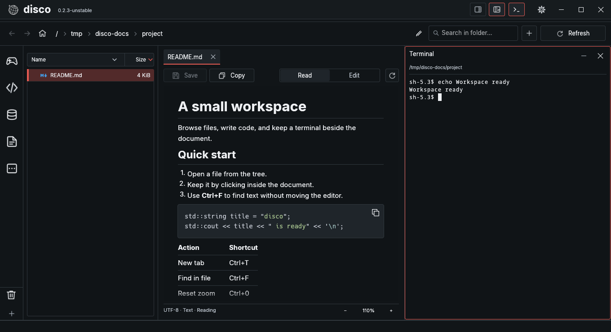

<p align="center">
  <picture>
    <source media="(prefers-color-scheme: dark)" srcset="assets/disco.svg">
    
  </picture>
</p>
<h1 align="center">disco</h1>
<p align="center"><strong>Your disk, files and terminal in one native workspace.</strong><br>Built with Rust · Linux · No browser engine</p>
<p align="center"><a href="#install">Install</a> · <a href="docs/guide.md">User guide</a> · <a href="CHANGELOG.md">What's new</a> · <a href="README.uk.md">Українська</a></p>

**Development: 0.2.3-unstable.** Work is staged on `disco-0.2.3-unstable`; [main](https://github.com/hiddensudo/disco) remains stable.

A native Linux disk space analyzer with file previews, text editing, and an integrated terminal. Built with Rust and egui, without a background indexing service.

**[What’s new in 0.2.3-unstable](CHANGELOG.md#023-unstable--in-development)** · **English** / [Українська](README.uk.md)



## Install

Build without host Rust/dev packages: `./scripts/build-docker.sh`. See the [Docker build and runtime guide](docs/docker.md).

You need Linux, **Rust 1.95+**, a C compiler, Git and Python 3. The UI uses Wayland or X11 with OpenGL.

```sh
git clone --branch disco-0.2.3-unstable https://github.com/hiddensudo/disco.git
cd disco
cargo build --release --locked
python3 install.py
```

Launch **disco** from the application menu or run `~/.local/bin/disco`. To keep development settings/cache separate, use `python3 install.py --config-dir ~/.config/disco-unstable` for the installation step.

<details>
<summary>Update or run without installing</summary>

```sh
git pull --ff-only
cargo build --release --locked
```

The launcher points to this checkout, so keep it in place. Run `./target/release/disco` without installing. With a custom Cargo output directory, pass `python3 install.py --binary /path/to/disco`.

</details>

## Start here

1. Click the drive name, choose a folder, then **Scan**. The last scan is restored on your next launch.
2. Expand folders and sort by size. Use categories to group places you care about.
3. Choose **Overview** for storage and properties, or **Focus** for a document and its folder tree.
4. Click **Terminal** to open a shell in the selected folder. **–** hides it; **×** ends the session.

The bottom-left **···** menu contains Large files, Cleanup and Duplicates. Deleting a file or folder asks for confirmation and moves it to Trash; permanent removal has its own confirmation.

## Two layouts, one workspace

| Overview | Focus |
| --- | --- |
| Disk usage, folder sizes and file properties | Folder tree, document tabs and syntax highlighting |
| Terminal below the tree and category rail | Terminal beside the document |
| Full-height properties on the right | More space for reading and editing |

*Native 0.2.3-unstable screenshots use demonstration data on a private virtual display.*

## What else can it do?

- Preview images and text; edit complete text files with conflict checks.
- Start a blank text tab with Ctrl+T; choose its path on the first Ctrl+S. Existing text files support optional auto-save.
- Refresh the current scope; enable live updates and read-only mode per category.
- Create custom categories, import icons, and configure them with separate TOML files.
- Restore items from Trash and see its size separately; Trash refreshes without rescanning folders.
- Read Markdown with full-height code blocks; find text in a floating panel and zoom with Ctrl+wheel.
- Follow external file edits from terminal tools while protecting local drafts.
- Enable language servers for completion, diagnostics and parameter help; see the [illustrated LSP guide](docs/language-servers.md).
- Choose dark/light presets, create a theme and set prompt language independently from the UI.

Open a file with `disco README.md` or a workspace with `disco /path/to/project`. **Ctrl+L** edits the path with file/folder suggestions. Opening a file needs no scan; explicitly opening a workspace folder starts its scan.

## Handy keys

| Key | Action |
| --- | --- |
| ↑ / ↓, Enter | Select a file or enter a folder |
| Ctrl+F | Focus: find in file; Overview: filename search |
| Ctrl+Plus / Minus, Ctrl+0 | File zoom / reset; Ctrl+wheel also works |
| Ctrl+Space / Ctrl+Shift+Space | Code completion / parameter help (LSP) |
| F5 | Refresh the current scope |
| Ctrl+T | New in-memory text tab; Ctrl+S chooses its first save path |
| Ctrl+S / Ctrl+N | Save / create a file, including `new_folder/file.txt` |
| Ctrl+Tab / Ctrl+Shift+Tab | Next / previous open tab, wrapping |
| Ctrl+Alt+arrows | Move focus between panels |
| Ctrl+Shift+C / V | Copy / paste in the terminal |

In Focus, browsing reuses one temporary tab. Click inside its document/image, edit, or press Enter/→ in the tree to keep it. A second → focuses the document. The terminal session survives hiding and layout changes. Closing it with × ends its processes.

## More detail

- [User guide](docs/guide.md) — terminal controls, tabs, categories, previews, settings and current limitations.
- [Development](docs/development.md) — checks, source map and component licenses.
- [Release history](CHANGELOG.md) · [Category TOML example](categories.example.toml)

- [LSP setup with screenshots](docs/language-servers.md) — installation, completion versus signature help, and troubleshooting.
- [Ready-to-open C++ example](docs/examples/lsp/main.cpp) — `disco docs/examples/lsp/main.cpp` from this checkout.
