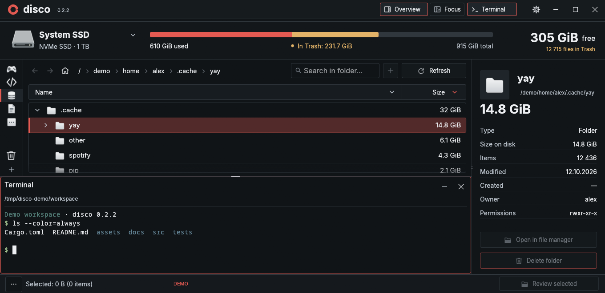
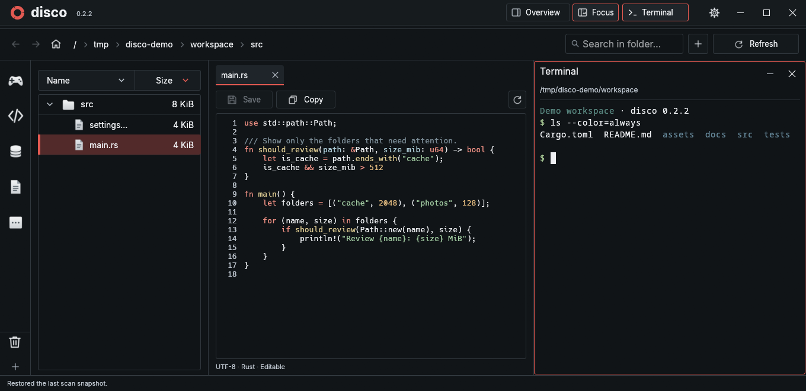

# disco

**Development: 0.2.3-unstable.** Work is staged on `disco-0.2.3-unstable`; [main](https://github.com/hiddensudo/disco) remains stable.

A native Linux disk space analyzer with file previews, text editing, and an integrated terminal. Built with Rust and egui, without a background indexing service.

**[0.2.2 release notes](CHANGELOG.md#022--2026-10-29)** · **English** / [Українська](README.uk.md)



## Install

You need Linux, **Rust 1.95+**, a C compiler, Git and Python 3. The UI uses Wayland or X11 with OpenGL.

```sh
git clone https://github.com/hiddensudo/disco.git
cd disco
cargo build --release --locked
python3 install.py
```

Launch **disco** from the application menu or run `~/.local/bin/disco`.

<details>
<summary>Update or run without installing</summary>

```sh
git pull --ff-only
cargo build --release --locked
```

The launcher points to this checkout, so keep it in place. Run `./target/release/disco` without installing. With a custom Cargo output directory, pass `python3 install.py --binary /path/to/disco`.

</details>

## Start here

1. Click the drive name, choose a folder, then **Scan**. The last scan is restored on your next launch.
2. Expand folders and sort by size. Use categories to group places you care about.
3. Choose **Overview** for storage and properties, or **Focus** for a document and its folder tree.
4. Click **Terminal** to open a shell in the selected folder. **–** hides it; **×** ends the session.

The bottom-left **···** menu contains Large files, Cleanup and Duplicates. Deleting a file or folder asks for confirmation and moves it to Trash; permanent removal has its own confirmation.

## Two layouts, one workspace

| Overview | Focus |
| --- | --- |
| Disk usage, folder sizes and file properties | Folder tree, document tabs and syntax highlighting |
| Terminal below the tree and category rail | Terminal beside the document |
| Full-height properties on the right | More space for reading and editing |



*Native screenshots from 0.2.2 using demonstration data.*

## What else can it do?

- Preview images and text; edit complete text files with conflict checks.
- Start a blank text tab with Ctrl+T; choose its path on the first Ctrl+S. Existing text files support optional auto-save.
- Refresh the current scope; enable live updates and read-only mode per category.
- Create custom categories, import icons, and configure them with separate TOML files.
- Restore items from Trash and see its size separately; Trash refreshes without rescanning folders.
- Change colors, spacing, text size and language in a separate settings window.

## Handy keys

| Key | Action |
| --- | --- |
| ↑ / ↓, Enter | Select a file or enter a folder |
| Ctrl+L / F5 | Search / refresh the current scope |
| Ctrl+T | New in-memory text tab; Ctrl+S chooses its first save path |
| Ctrl+S / Ctrl+N | Save / create a file, including `new_folder/file.txt` |
| Ctrl+Tab / Ctrl+Shift+Tab | Preview the next / previous visible file |
| Ctrl+Alt+arrows | Move focus between panels |
| Ctrl+Shift+C / V | Copy / paste in the terminal |

In Focus, keyboard browsing reuses one temporary tab. Enter or → keeps it open; a second → focuses the document. The terminal session survives hiding and layout changes. Closing it with × ends its processes.

## More detail

- [User guide](docs/guide.md) — terminal controls, tabs, categories, previews, settings and current limitations.
- [Development](docs/development.md) — checks, source map and component licenses.
- [Release history](CHANGELOG.md) · [Category TOML example](categories.example.toml)
