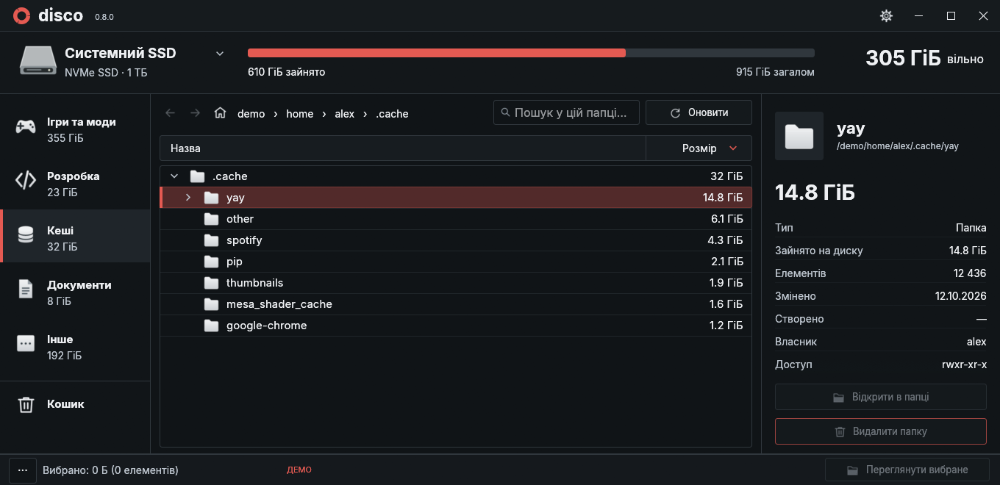
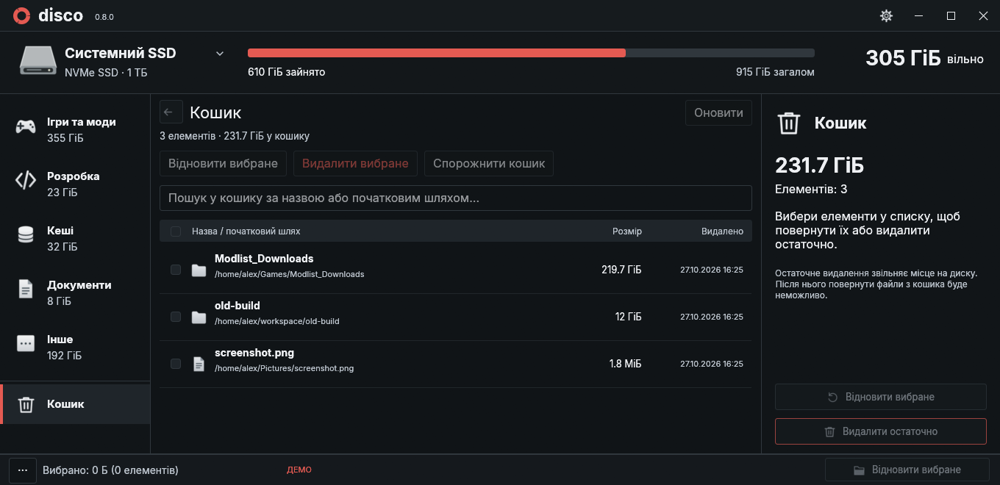
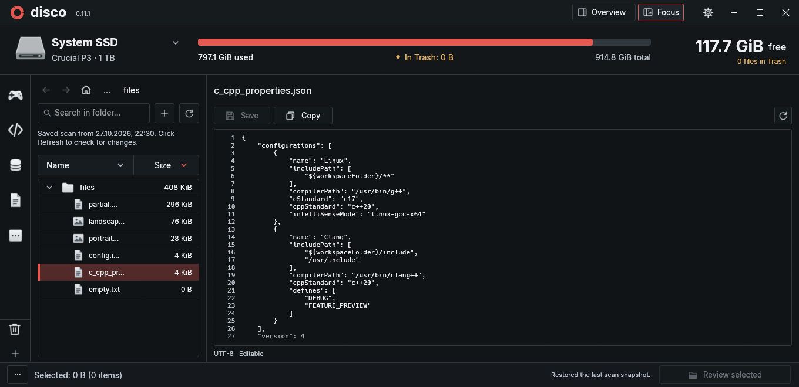

# disco

Current release: **0.2.1** ([source tag](https://github.com/hiddensudo/disco/tree/v0.2.1)).

### Integrated terminal

The **Terminal** button beside Overview/Focus opens the terminal. Focus places it in a resizable right-hand column. Overview places it below the category rail and file list, with adjustable height; properties remain visible on the right at full height. It starts the system shell in the selected folder, or the selected file's parent. The shell starts only on first opening. Browsing elsewhere does not change an existing session's working directory.

The title-bar button and the terminal header's **–** hide the panel while preserving the shell and its output. The header's **×** ends the shell and its foreground/background processes and returns the column to the document. Opening again starts a fresh session. Closing disco also ends its terminal session. Switching between Overview and Focus moves the same running session between the bottom panel and right-hand column. The category rail becomes compact while the bottom panel is open; hiding or closing it restores the file list and rail to full height.

Terminal input stays local: Enter/Delete/Ctrl+S/Ctrl+N/Ctrl+W do not act on files. **Ctrl+Alt+Left** returns to the document, and **Ctrl+Alt+Right** from the document focuses the visible terminal. In Overview, **Ctrl+Alt+Up/Down** moves between the terminal and file list. **Ctrl+Shift+C/V** copy/paste; **Ctrl+C** interrupts. System monospace/symbol fonts are loaded through Fontconfig on first use, and launcher-inherited `NO_COLOR` is removed only from the PTY subprocess environment. Existing shells keep their own configuration. No language server is started by this feature.

**English** · [Українська](README.uk.md)

A native disk space analyzer for Linux. Built with Rust and egui, with a dark interface and no always-running indexing service.



## Features

- Browse a folder tree, sort by size, search, and filter by category.
- Overview and Focus layouts, a compact category rail, and file properties in Overview.
- Custom folder collections, 38 built-in SVG icons, imported icons, and agent-ready TOML prompts.
- Inspect file and folder properties, find large files, and compare duplicate file contents.
- Preview images and text in the right inspector or in a resizable area beside the list.
- Double-click files to open their default application; this can be disabled.
- Automatically save the last scan and restore it on startup.
- Refresh the current scope, with optional live updates and read-only policies for each category.
- Move folders to Trash with confirmation; restore items or empty Trash.
- See Trash usage and file count separately in the drive's storage bar.
- Customize themes, colors, text size, layout, and animations through settings or TOML.
- Switch between English and Ukrainian without restarting.

## Install

Requires **Linux**, **Rust 1.95+** with Cargo, a C compiler (GCC or Clang), Git, and Python 3. The desktop UI needs Wayland or X11 and an OpenGL driver.

```sh
git clone https://github.com/hiddensudo/disco.git
cd disco
cargo build --release --locked
python3 install.py
```

Open **disco** from your application menu or run `~/.local/bin/disco`. To run without installing: `./target/release/disco`.

The installer creates a launcher pointing to your build, so keep the project directory in place. To update, run `git pull` and rebuild. For a custom Cargo output directory, use `python3 install.py --binary /path/to/disco`.

## Use

1. Click the drive name at the top left, choose a folder, and click **Scan**. You can pause or cancel the scan.
2. Click folders to expand the tree. Categories default to an icon rail; hover for names. The title-bar buttons switch Overview and Focus. Navigation arrows and mouse side buttons go back and forward.
3. Open **Large files**, **Cleanup**, or **Duplicates** from the **···** menu at the bottom left. **Delete folder** is in the properties panel.
4. In **Trash**, select items to restore or permanently delete. Emptying Trash requires a separate confirmation.
5. Open the gear icon to customize the interface. The **Language** selector is at the top of the settings window: choose **English** or **Українська**, then click **Save** to remember your choice. **Cancel** restores your previous preferences.



*Screenshots use demonstration data.*

Trash remains part of used space until it is emptied. Its amber segment is included in used storage, rather than added again; click the Trash label to open it. Change this color under **Appearance → Additional colors**.

Sizes use allocated disk blocks. Symbolic links are not followed, and scans stay on one filesystem. **Refresh / F5** rereads the current folder scope, or the current category’s roots. Unrelated subtrees are preserved. Live updates use filesystem events rather than changes in total SSD usage.

Preferences: `~/.config/disco/{theme,layout}.toml`. Last scan: `~/.cache/disco/last-scan.bin.gz`. `XDG_CONFIG_HOME` and `XDG_CACHE_HOME` are supported. In `layout.toml`, `language = "en"` selects English and `language = "uk"` selects Ukrainian. Existing configurations without a language setting keep Ukrainian.

```sh
./target/release/disco --demo          # sample data; no scanning or deletion
./target/release/disco --trash         # open Trash directly
./target/release/disco --scan /path    # scan in the terminal
cargo test --locked
python3 -m unittest discover -s tests
```

## Keyboard workspace

Use **Ctrl+Alt+arrows** to move between categories, the tree, tabs, the editor and search. **F6 / Shift+F6** cycles through available panels; the focused panel has an accent outline. Editor cursor and selection remain where you left them. **Ctrl+arrows** still move through text normally.

- Categories: **Up/Down**, then **Enter**; **Ctrl+Shift+Up/Down** changes their order when unlocked. Trash is the final fixed entry.
- Tabs: **Left/Right**, then **Enter**; **Ctrl+W** closes the active document with draft protection.
- **Ctrl+L** focuses scope search; **Ctrl+comma** opens or raises Settings; **Alt+Home** opens the configured Home folder.
- **Tab / Shift+Tab**, **Space / Enter** and **Escape** operate controls, settings and dialogs. **F6** leaves the code editor without inserting a tab character.

## Focus tabs

Focus keeps opened files in tabs. Keyboard file browsing reuses one temporary tab, shown in italics, instead of creating a tab for each selection. The first **Enter** or **Right arrow** keeps that tab open. On an already retained file, **Enter** opens its default application when an association exists; **Right arrow** focuses the document. Typing also retains a preview to protect the draft. Mouse selections continue opening retained tabs. Switching retained files or browsing another category keeps each draft, cursor and scroll position. An existing file activates its existing tab; middle-click or × closes a tab. Unsaved tabs show a dot and ask before closing; closing the app checks inactive drafts too. Auto-save and read-only policies follow the category where the document was opened. Background auto-save continues for inactive text tabs. Only the visible image keeps a decoded texture; up to 64 document tabs can remain open.

## Settings window

Settings open in a separate resizable window with sections on the left. Reopening activates the same window and keeps its draft. Save applies the settings permanently; Cancel, Escape or the close button restores the previous settings. Your file draft, cursor and folder context stay in the main window.

## Auto-save

Auto-save is off by default. Enable it per category under **Settings → Categories**, or for All folders under **Interface → Panels, Home & search**. Changes are saved after one second without typing, using the same background writer and conflict checks as Ctrl+S. The editor stays focused. Read-only categories never write; a failed save keeps the draft and shows the error without repeatedly retrying. Save/Discard/Cancel still protects a draft when leaving before its deadline.

## Scoped updates, code highlighting and Home (0.2)

**Refresh** and **F5** update the current folder when you have entered one, otherwise the active category’s roots. Multiple category roots are read independently. The existing selection, expanded tree, navigation history and unsaved text are retained. Automatic categories prune nested directories belonging to other categories.

Under **Settings → Categories**, each category has **Live file updates** and **Read only in disco**. Both default to off. Live monitoring runs only for the active category/scope while disco is open. It watches directories already present in the snapshot, with bounded event queues and coalescing; an ordinary file change rereads its parent directory, not the entire category. New directories are added to monitoring after discovery. The first activation synchronizes the scope. Watch-limit and permission errors are shown in the status bar.

Read-only categories still support selection, copying and previewing. Editing, saving, file creation and deletion are disabled in disco; operating-system permissions and external applications are unchanged. External changes reload clean documents while preserving the cursor. Dirty documents remain in memory and the existing conflict check prevents overwriting external changes. The legacy global `auto_refresh` SSD trigger is no longer used.

**Settings → Interface → Panels, Home & search** contains the Home path (default `/home`, falling back to `/` when unavailable), the optional Home search fallback, and live/read-only policies for **All folders**. Search includes files in unopened directories. It searches the current scope first; only an empty scope result enables the optional Home pass. Search jobs are cancellable and limited to 2,000 displayed results.

Programming/configuration files use [syntect](https://docs.rs/syntect/) with [bat/two-face grammars](https://docs.rs/two-face/). Rust, Python, JSON, TOML, JavaScript/TypeScript, YAML and many other formats are detected from the filename or shebang. Parsing runs on one background worker. Unchanged frames reuse cached colored text layout. The dark palette contains no purple. Extremely long lines use plain text to bound parser work. Syntax asset licenses are available in About, through `--syntax-licenses`, and in [licenses/syntaxes.md](licenses/syntaxes.md).

## Categories and viewing layouts (0.2)

The category rail shows icons by default; names are optional under **Settings → Interface → Category labels**. The title bar has exactly two fixed, labeled layout buttons: **Overview** and **Focus**. **Overview** shows the list, preview and properties. **Focus** has a full-width path/search toolbar, a resizable folder tree on the left and the document on the right. Drive usage, selection counts and properties stay in Overview. Entering Focus opens the complete category tree and expands the selected item's ancestors. The same two choices are available under **Default file view**, and the selected mode is remembered. Mode buttons are not duplicated in document headers or a side rail.

Breadcrumbs follow the selected folder or the selected file's parent. Their components are clickable, with hidden ancestors under **…**. Narrow tree panels put navigation and search on separate rows with consistent padding. Unsaved edits are guarded during navigation.

Drag category icons or rows to reorder them; the insertion line shows the destination. The order is saved in the shared category index. Trash stays fixed at the bottom. **Settings → Interface → Lock category order** disables reordering and is off by default.

Under **Settings → Categories**, create or rename a collection, choose from 38 vector icons or import your own SVG/PNG/JPEG/WebP, and add folders with Browse or an absolute path. Right-click a category to add the currently selected folders. Removing a category or a path only changes the collection. Changes take effect when you click **Save**; **Cancel** discards them.

Collections are overlays: the same folder can appear in several categories. Nested roots within one collection are counted once. A built-in category with no explicit folders uses automatic rules; assigning folders replaces its rules with those paths. Sizes reflect the current scan snapshot. Folders outside it are listed with **Scan** buttons; scanning one replaces the current snapshot, so scanning a common parent is useful for collections with several roots on the same filesystem.

`~/.config/disco/categories.toml` is a shared index (`version = 2`, `files = ["categories/photos.toml", …]`). Each category is a separate TOML file containing `version = 1`, `id`, `name`, `icon` and `folders`. See [categories.example.toml](categories.example.toml). Existing single-file lists migrate automatically, with an exact `.bak` copy kept beside the index. Valid edits to either the index or an individual category reload while settings are closed; invalid edits keep the last valid state. Conflicting external edits are not silently overwritten by the settings editor.

The robot is only in **Settings → Categories**, while creating or editing a category. It copies a prompt in the interface language with that category's file path, name and schema. Paste it into an agent with PC access to find and assign folders (for example photos, Steam games or Epic games). For an unsaved new category, the prompt also explains how to create the file and register it in the index. disco makes no AI/network requests. Hover gives a brief spring animation, respecting reduced-motion settings.


Imported assets are copied into `~/.config/disco/icons/`; keep that directory when sharing your configuration. SVG icons retain their vectors and render at display DPI. Raster imports are normalized to a bounded 256 px icon. Icons are limited to 2 MiB; embedded/external SVG image resources are not loaded. The folder collections do not add a background disk indexer.



## File previews

Expand a folder to load its files, then select a file. Use **Overview / Focus** in the title bar to change layout. Both modes retain image fit/zoom and text editing. Portrait images get a taller canvas automatically and preserve their proportions. In Focus, drag the divider to resize the tree (240–480 px). Preview status uses one line, including for truncated text files.

Drag the left edge of the properties panel to change its width (240–760 px, subject to available window space). The settings slider updates immediately, and the width is saved on release. Settings changes still apply in both directions. Wheel scrolling over a document stays inside it at its top and bottom; scroll outside the editor or use the outer scrollbar to move the properties panel.

Complete text files open directly in an editor. Click the text to type; clicking the empty editor area below the text places the cursor at the end of the file; **Save** or **Ctrl+S** writes the changes. Copy and Reload have the same 30 px toolbar height as the image controls. Leaving an edited file, reloading, rescanning, deleting it, or closing the app asks whether to save, discard, or cancel. An external file change causes a save error and keeps the draft. Saves preserve encoding, BOM, the file's line-ending convention, permissions, and extended attributes; fragments of large files remain read-only.

**Settings → Interface → Default file view** also controls the mode and **Double click opens files in the default app** (enabled by default). Double-click opening can be disabled independently of the explicit **Enter** action. Only installed system associations are launched; without one, nothing opens. This integration uses `xdg-mime` and `gio` (typically provided by `xdg-utils` and GLib).

In the file list/tree:

| Key | Action |
| --- | --- |
| ↑ / ↓, Home / End, Page Up / Down | Move the selection and scroll it into view |
| → / ← | Expand/collapse folders; Right on a Focus file retains its preview, then focuses the document |
| Enter | Enter a folder; in Focus, first retain a preview, then open a retained file in its default app |
| Backspace | Go back; otherwise select the parent |
| Delete | Move the selected file or folder to Trash, after confirmation |
| F5 | Refresh the current scope |
| Ctrl+Tab / Ctrl+Shift+Tab | Preview the next / previous visible file, skipping folders |
| Escape | Leave text editing or clear the search without changing layout |

List navigation shortcuts are disabled while typing in an editor or search field. **Ctrl+S** remains the save shortcut. **Ctrl+Tab / Ctrl+Shift+Tab** also work inside the editor and search: they follow the current tree/list order, skip collapsed folders, and stop at the first/last file. In Overview, unsaved changes trigger Save/Discard/Cancel. In Focus, retained documents stay open and unedited temporary previews are replaced in the same slot. The shortcuts follow the file list, not tab order.

**Ctrl+S** keeps the editor focused, including while the save runs in the background. You can keep typing; any newer changes remain unsaved until the next save. System **Ctrl+C / Ctrl+X / Ctrl+V** works in editable text fields on Wayland and X11.

Use **+** next to Refresh or **Ctrl+N** to create a file in the selected folder (or the selected file's parent). Enter a name with any extension, or a nested path such as `new_folder/file.txt`. A leading `/` also stays relative to the selected folder. Missing parent folders are created and appear immediately in the current tree. Invalid paths keep the dialog open and return focus to the input. Existing files are never overwritten; the new empty file opens in the editor immediately.

Search is limited to the current folder scope. Click a matching folder to enter that scope and clear the query; subsequent searches run inside it. Clearing a query keeps the selected item visible by expanding its ancestors. Use breadcrumbs, Back, or Home to leave the scope. Both Name and Size headers show sorting arrows and toggle the sort direction.

Supported images: PNG, JPEG, WebP, BMP, TIFF. Text supports UTF-8 and UTF-16 with a byte-order mark. Only the selected file is read, in the background. To limit resource usage, image previews accept files up to 32 MiB and 12 megapixels and retain a thumbnail up to 2048 px; text previews read up to 128 KiB / 2,000 lines. Unsupported or larger content displays an explanatory preview message; properties are available in Files mode. Expanded-directory listings are cached separately from the saved scan and are bounded; a shortened listing is labeled explicitly. Search includes folder names and already loaded file listings.

In `layout.toml`: `preview_mode = "overview"` (Overview) or `"focus"` (Focus), and `open_files_on_double_click = true` (or `false`).

## Source layout

- `src/main.rs`: command-line entry points and native window startup.
- `src/app.rs` and `src/app/{state,jobs}.rs`: application lifecycle, grouped state, and background job coordination.
- `src/app/ui/`: window chrome, folder browser, inspector, Trash, dialogs, and settings pages.
- `src/index.rs`, `src/filesystem.rs`, `src/format.rs`: scan navigation index, filesystem metadata, and display formatting.
- `src/{file_preview,text_editor,directory_files,associations}.rs`: bounded content loading, document saves, lazy file listings, and default-app integration.
- `src/categories.rs` and `src/categories/store.rs`: validated TOML collections, manifest migration, localized agent prompts, reload/conflict handling.
- `src/{scan,snapshot,recycle,deletion}.rs`: scanning, persistence, and Trash operations; independent of UI state.

Inter font: [SIL Open Font License](assets/fonts/LICENSE.txt). Local Trash library patch: [notes and license](vendor/trash/DISCO-PATCH.md).

See [CHANGELOG.md](CHANGELOG.md) for the development history.
