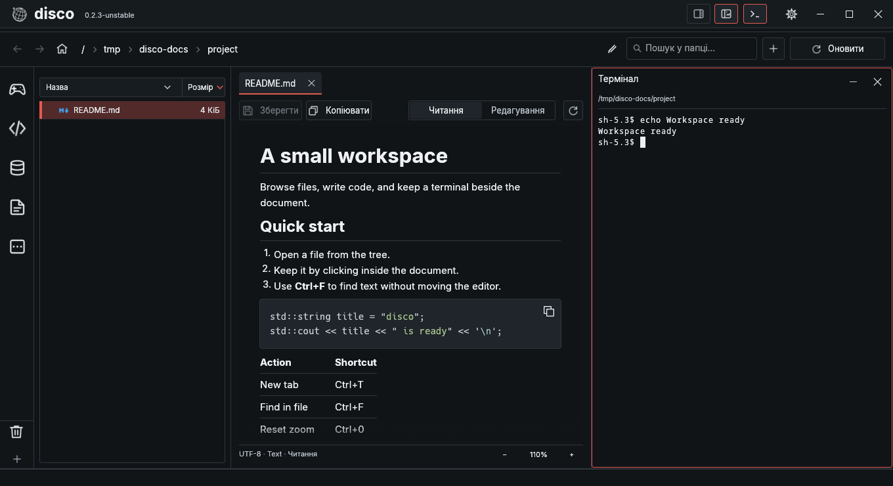

<p align="center">
  <picture>
    <source media="(prefers-color-scheme: dark)" srcset="assets/disco.svg">
    
  </picture>
</p>
<h1 align="center">disco</h1>
<p align="center"><strong>Диск, файли й термінал в одному нативному робочому просторі.</strong><br>Створено на Rust · Linux · Без браузерного рушія</p>
<p align="center"><a href="#встановлення">Встановлення</a> · <a href="docs/guide.uk.md">Посібник</a> · <a href="CHANGELOG.md">Що нового</a> · <a href="README.md">English</a></p>

**Розробка: 0.2.3-unstable.** Зміни готуються в `disco-0.2.3-unstable`; [main](https://github.com/hiddensudo/disco) залишається стабільним.

Нативний аналізатор місця на диску для Linux із прев’ю файлів, редагуванням тексту та вбудованим терміналом. Rust + egui, без фонового індексатора.

**[Що нового в 0.2.3-unstable](CHANGELOG.md#023-unstable--in-development)** · [English](README.md) / **Українська**



## Встановлення

Збірка без Rust/dev-пакетів на хості: `./scripts/build-docker.sh`. Дивись [Docker-збірку та вимоги запуску](docs/docker.uk.md).

Потрібні Linux, **Rust 1.95+**, C-компілятор, Git та Python 3. Інтерфейс працює через Wayland або X11 з OpenGL.

```sh
git clone --branch disco-0.2.3-unstable https://github.com/hiddensudo/disco.git
cd disco
cargo build --release --locked
python3 install.py
```

Запускай **disco** з меню програм або командою `~/.local/bin/disco`. Для окремих development-налаштувань і кешу встановлюй через `python3 install.py --config-dir ~/.config/disco-unstable`.

<details>
<summary>Оновлення або запуск без встановлення</summary>

```sh
git pull --ff-only
cargo build --release --locked
```

Ярлик посилається на цю папку проєкту, тому залиш її на місці. Без встановлення запускай `./target/release/disco`. Для іншого каталогу збірки: `python3 install.py --binary /path/to/disco`.

</details>

## З чого почати

1. Натисни назву диска, вибери папку й запусти **Сканувати**. Останній скан відновиться при наступному запуску.
2. Розгортай папки та сортуй за розміром. Категорії об’єднують потрібні тобі директорії.
3. Обирай **Огляд** для місця й властивостей або **Фокус** для документа та дерева папок.
4. Натисни **Термінал**, щоб відкрити оболонку у вибраній папці. **–** ховає її, **×** завершує сесію.

У меню **···** знизу ліворуч є великі файли, очищення та дублікати. Видалення файла чи папки потребує підтвердження й переміщує їх у кошик; остаточне видалення підтверджується окремо.

## Два режими одного робочого простору

| Огляд | Фокус |
| --- | --- |
| Зайняте місце, розміри папок і властивості | Дерево папок, вкладки та підсвічування коду |
| Термінал знизу під деревом і категоріями | Термінал праворуч від документа |
| Властивості праворуч на повну висоту | Більше місця для читання й редагування |

*Нативні скріни 0.2.3-unstable — демонстраційні дані на приватному віртуальному дисплеї.*

## Що ще вміє?

- Прев’ю картинок і тексту; редагування повних текстових файлів із перевіркою конфліктів.
- Нова текстова вкладка через Ctrl+T; шлях при першому Ctrl+S. Для файлів доступне автозбереження.
- Оновлення поточного скоупу, автооновлення й режим лише читання для кожної категорії.
- Власні категорії, імпорт іконок та конфігурація окремими TOML-файлами.
- Відновлення з кошика, окремий обсяг на смузі диска й оновлення без пересканування папок.
- Markdown із повнорозмірними блоками коду, плаваючий пошук і масштаб через Ctrl+коліщатко.
- Оновлення файла після змін у терміналі зі збереженням локальної чернетки.
- Мовні сервери для підказок, параметрів, переходу F12 та нижньої панелі проблем: [наочна інструкція LSP](docs/language-servers.uk.md).
- Темні/світлі пресети, створення теми й незалежна мова AI-промптів.

Відкрий файл через `disco README.md` або проєкт через `disco /path/to/project`. **Ctrl+L** редагує адресу з підказками файлів і папок. Файл відкривається без сканування; явне відкриття папки проєкту запускає її сканування.

## Корисні клавіші

| Клавіші | Дія |
| --- | --- |
| ↑ / ↓, Enter | Вибрати файл або зайти в папку |
| Ctrl+F | Focus: пошук у файлі; Overview: пошук за назвою |
| Ctrl+Plus / Minus, Ctrl+0 | Масштаб файла / скидання; також Ctrl+коліщатко |
| Ctrl+Space / Ctrl+Shift+Space | Підказки коду / параметри (LSP) |
| F5 | Оновлення поточного скоупу |
| Ctrl+T | Нова чернетка; перше Ctrl+S запитує шлях |
| Ctrl+S / Ctrl+N | Зберегти / створити файл, зокрема `new_folder/file.txt` |
| Ctrl+Tab / Ctrl+Shift+Tab | Наступна / попередня відкрита вкладка, по колу |
| Ctrl+Alt+стрілки | Переміщення фокусу між панелями |
| Ctrl+Shift+C / V | Копіювання / вставлення в терміналі |

У Фокусі вибір файлів використовує одну тимчасову вкладку. Клік усередині документа/зображення, редагування або Enter/→ у дереві закріплює її. Наступне → переводить у документ. Згортання й зміна режиму зберігають термінальну сесію. Хрестик × завершує її процеси.

## Докладніше

- [Посібник користувача](docs/guide.uk.md) — термінал, вкладки, категорії, прев’ю, налаштування й поточні обмеження.
- [Розробка](docs/development.md) — перевірки, структура коду та ліцензії компонентів (англійською).
- [Історія змін](CHANGELOG.md) · [Приклад категорій у TOML](categories.example.toml)

- [LSP зі скрінами](docs/language-servers.uk.md) — встановлення, відмінність списку підказок від сигнатур і перевірка проблем.
- [Готовий C++-приклад](docs/examples/lsp/main.cpp) — `disco docs/examples/lsp/main.cpp` із цього репозиторію.
