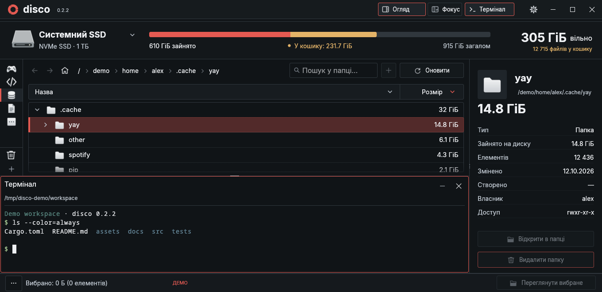
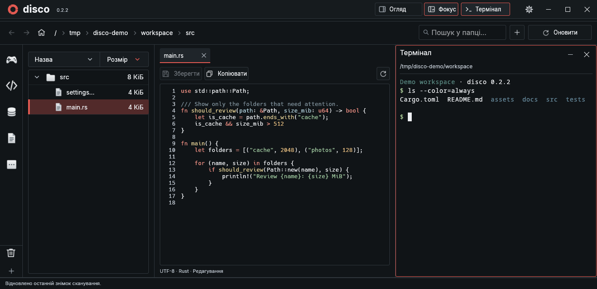

# disco

Нативний аналізатор місця на диску для Linux із прев’ю файлів, редагуванням тексту та вбудованим терміналом. Rust + egui, без фонового індексатора.

**[Що нового в 0.2.2](CHANGELOG.md#022--2026-10-29)** · [English](README.md) / **Українська**



## Встановлення

Потрібні Linux, **Rust 1.95+**, C-компілятор, Git та Python 3. Інтерфейс працює через Wayland або X11 з OpenGL.

```sh
git clone https://github.com/hiddensudo/disco.git
cd disco
cargo build --release --locked
python3 install.py
```

Запускай **disco** з меню програм або командою `~/.local/bin/disco`.

<details>
<summary>Оновлення або запуск без встановлення</summary>

```sh
git pull --ff-only
cargo build --release --locked
```

Ярлик посилається на цю папку проєкту, тому залиш її на місці. Без встановлення запускай `./target/release/disco`. Для іншого каталогу збірки: `python3 install.py --binary /path/to/disco`.

</details>

## З чого почати

1. Натисни назву диска, вибери папку й запусти **Сканувати**. Останній скан відновиться при наступному запуску.
2. Розгортай папки та сортуй за розміром. Категорії об’єднують потрібні тобі директорії.
3. Обирай **Огляд** для місця й властивостей або **Фокус** для документа та дерева папок.
4. Натисни **Термінал**, щоб відкрити оболонку у вибраній папці. **–** ховає її, **×** завершує сесію.

У меню **···** знизу ліворуч є великі файли, очищення та дублікати. Видалення файла чи папки потребує підтвердження й переміщує їх у кошик; остаточне видалення підтверджується окремо.

## Два режими одного робочого простору

| Огляд | Фокус |
| --- | --- |
| Зайняте місце, розміри папок і властивості | Дерево папок, вкладки та підсвічування коду |
| Термінал знизу під деревом і категоріями | Термінал праворуч від документа |
| Властивості праворуч на повну висоту | Більше місця для читання й редагування |



*Нативні скріншоти 0.2.2 на демонстраційних даних.*

## Що ще вміє?

- Прев’ю картинок і тексту; редагування повних текстових файлів із перевіркою конфліктів.
- Чернетки у вкладках та опційне автозбереження після секунди без набору.
- Оновлення поточного скоупу, автооновлення й режим лише читання для кожної категорії.
- Власні категорії, імпорт іконок та конфігурація окремими TOML-файлами.
- Відновлення з кошика, окремий обсяг на смузі диска й оновлення без пересканування папок.
- Зміна кольорів, відступів, масштабу тексту й мови в окремому вікні налаштувань.

## Корисні клавіші

| Клавіші | Дія |
| --- | --- |
| ↑ / ↓, Enter | Вибрати файл або зайти в папку |
| Ctrl+L / F5 | Пошук / оновлення поточного скоупу |
| Ctrl+S / Ctrl+N | Зберегти / створити файл, зокрема `new_folder/file.txt` |
| Ctrl+Tab / Ctrl+Shift+Tab | Прев’ю наступного / попереднього видимого файла |
| Ctrl+Alt+стрілки | Переміщення фокусу між панелями |
| Ctrl+Shift+C / V | Копіювання / вставлення в терміналі |

У Фокусі перебір клавіатурою використовує одну тимчасову вкладку. Enter або → залишає її відкритою; наступне → переводить у документ. Згортання й зміна режиму зберігають термінальну сесію. Хрестик × завершує її процеси.

## Докладніше

- [Посібник користувача](docs/guide.uk.md) — термінал, вкладки, категорії, прев’ю, налаштування й поточні обмеження.
- [Розробка](docs/development.md) — перевірки, структура коду та ліцензії компонентів (англійською).
- [Історія змін](CHANGELOG.md) · [Приклад категорій у TOML](categories.example.toml)
