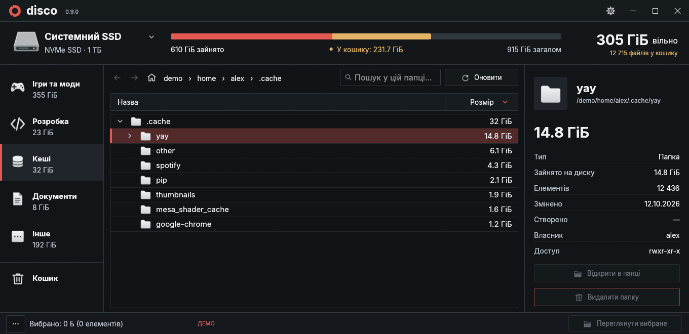
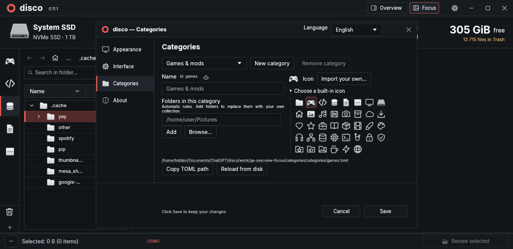
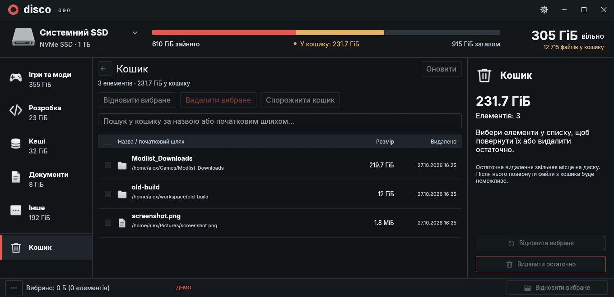

# disco

Поточна збірка: **0.2.2** — вбудований термінал, виправлена клавіатурна навігація та непрозорий фон вікна. Див. [нотатки до релізу](CHANGELOG.md).

### Вбудований термінал

Кнопка **Термінал** біля Огляд/Фокус відкриває термінал. У Фокусі це права колонка зі змінною шириною. В Огляді термінал розміщено знизу під категоріями та списком, зі змінною висотою; властивості праворуч залишаються на повну висоту. Оболонка запускається лише при першому відкритті, у вибраній папці або батьківській папці вибраного файла. Перехід до інших папок не змінює директорію вже відкритої сесії.

Кнопка зверху та **–** у заголовку ховають панель зі збереженням сесії та виводу. **×** завершує оболонку, її активні й фонові процеси та повертає місце документу. Наступне відкриття створює нову сесію. Закриття disco також завершує термінал. Перемикання між Оглядом і Фокусом переносить ту саму сесію між нижньою панеллю та правою колонкою. Коли нижня панель відкрита, категорії показуються компактніше; згортання або закриття повертає повну висоту списку та категорій.

Клавіші у терміналі не керують файлами: Enter/Delete/Ctrl+S/Ctrl+N/Ctrl+W залишаються в оболонці. У Фокусі **Ctrl+Alt+←** повертає фокус у документ, **Ctrl+Alt+→** із документа переводить його у видимий термінал. В Огляді **Ctrl+Alt+↓** з категорій або списку переводить фокус у термінал, **Ctrl+Alt+↑** повертає до списку, а **Ctrl+Alt+→** веде у властивості (**←** повертає назад). Ліворуч/вниз із нижнього термінала фокус залишається на місці, без введення в оболонку. **Ctrl+Shift+C/V** копіюють/вставляють, **Ctrl+C** перериває процес. Системні моноширинні та додаткові шрифти завантажуються через Fontconfig при першому використанні; успадковане `NO_COLOR` прибирається лише в дочірньому PTY-процесі. Конфіг самої оболонки зберігається. Мовні сервери ця можливість не запускає.

[English](README.md) · **Українська**

Нативний аналізатор місця на диску для Linux. Rust + egui, темний інтерфейс, без постійного фонового індексатора.



## Можливості

- Дерево папок із сортуванням за розміром, пошуком і категоріями.
- Властивості файлів і папок, найбільші файли та пошук дублікатів за вмістом.
- Прев’ю картинок і текстів праворуч або у великій області поруч зі списком.
- Відкриття файлів подвійним кліком у типовій програмі з можливістю вимкнення.
- Збереження останнього скану та автоматичне відновлення при запуску.
- Оновлення поточного scope та окремі політики автооновлення й лише читання для категорій.
- Видалення папок у кошик із підтвердженням; відновлення та спорожнення кошика.
- Теми, власні кольори, масштаб і компонування інтерфейсу через налаштування або TOML.

Верхня смуга окремо позначає обсяг кошика та показує кількість файлів на вибраному диску. Натисни підпис кошика, щоб відкрити його; колір можна змінити в **Оформлення → Додаткові кольори**.

## Керування клавіатурою

**Ctrl+Alt+стрілки** переводять фокус між категоріями, деревом, вкладками, редактором і пошуком. **F6 / Shift+F6** циклічно обходять доступні області; активну область позначено акцентною рамкою. Позиція курсора й виділення редактора зберігаються. **Ctrl+стрілки** залишаються стандартними командами роботи з текстом.

- Категорії: **↑/↓**, потім **Enter**; **Ctrl+Shift+↑/↓** змінюють порядок, коли його не закріплено. Кошик — останній нерухомий елемент.
- Вкладки: **←/→**, потім **Enter**; **Ctrl+W** закриває активний документ із захистом чернетки.
- **Ctrl+L** фокусує пошук; **Ctrl+кома** відкриває чи піднімає налаштування; **Alt+Home** переходить у налаштований Home.
- **Tab / Shift+Tab**, **Space / Enter** і **Escape** керують кнопками, налаштуваннями й діалогами. **F6** дозволяє вийти з редактора коду без вставлення табуляції.

## Вкладки у Фокусі

У Фокусі відкриті файли зберігаються у вкладках. Перебір файлів клавіатурою використовує одну тимчасову вкладку, позначену курсивом. Перше **Enter** або **→** залишає її відкритою. Для вже закріпленого файла **Enter** запускає типову програму, якщо вона призначена; **→** переводить фокус у документ. Редагування також закріплює перегляд, щоб захистити чернетку. Вибір мишею й далі відкриває збережені вкладки. Перемикання закріплених файлів чи категорії залишає кожну чернетку, курсор і прокрутку. Повторне відкриття активує наявну вкладку; середня кнопка миші або × закриває її. Незбережені вкладки позначено крапкою; перед закриттям є підтвердження. Закриття програми перевіряє також неактивні чернетки. Автозбереження й режим лише читання беруться з категорії відкриття документа. Автозбереження працює й для неактивних текстових вкладок. Декодовану текстуру тримає лише видима картинка; одночасно доступно до 64 вкладок.

## Вікно налаштувань

Налаштування відкриваються в окремому вікні зі змінним розміром і розділами ліворуч. Повторне відкриття піднімає те саме вікно й залишає його чернетку. «Зберегти» записує налаштування; «Скасувати», Escape або хрестик відновлюють попередні значення. Чернетка файла, курсор і контекст папок залишаються в основному вікні.

## Автозбереження

Типово вимкнене. Увімкни його для категорії в **Налаштування → Категорії**, а для всіх папок — в **Інтерфейс → Панелі, Home та пошук**. Запис виконується після секунди без набору у фоні, з тими самими перевірками конфліктів, що й Ctrl+S. Фокус залишається в редакторі. Категорії лише для читання не записуються; помилка зберігає чернетку й показується без нескінченних повторних спроб. Якщо перейти до завершення затримки, чернетку захищає стандартне підтвердження збереження.

## Оновлення scope, підсвічування та Home (0.2)

**Оновити / F5** перечитує поточну папку, якщо в неї виконано перехід, або корені активної категорії. Кілька коренів категорії оновлюються окремо. Сусідні піддерева, вибір файла, розгорнуті папки, історія переходів і незбережений текст зберігаються. Автоматичні категорії пропускають вкладені каталоги інших категорій.

Перетягуй іконки чи рядки категорій для зміни порядку; лінія вставки показує місце призначення. Порядок зберігається у спільному індексі категорій. Кошик залишається внизу. **Налаштування → Інтерфейс → Закріпити порядок категорій** забороняє переміщення; типово цю опцію вимкнено.

У **Налаштування → Категорії** є **Автооновлення файлів** і **Лише читання в disco** для кожної категорії. Типово обидві опції вимкнені. Спостереження працює лише для активної категорії/scope, поки відкрито disco. Використовуються системні події, відомі зі знімка директорії та обмежена черга з об’єднанням подій. Звичайна зміна файла перечитує його батьківську папку; нові директорії додаються до спостереження після виявлення. Перше ввімкнення синхронізує scope. Помилки доступу або ліміту спостереження показуються в рядку стану.

Режим лише читання дозволяє перегляд і копіювання, але блокує редагування, запис, створення й видалення в disco. Права ОС та зовнішні програми не змінюються. Чистий документ оновлюється зі збереженням курсора; незбережена чернетка залишається в пам’яті, а перевірка конфлікту не дає перезаписати зовнішні зміни. Старий глобальний таймер `auto_refresh` за зміною обсягу SSD більше не використовується.

У **Налаштування → Інтерфейс → Панелі, Home та пошук** задається шлях Home: типово `/home`, за його відсутності — `/`. Там же є пошук у Home за відсутності результатів у scope та політики для **Усі папки**. Пошук охоплює також файли в нерозгорнутих папках, скасовується при зміні запиту й показує до 2000 результатів.

Код і конфіги підсвічує готовий рушій **syntect** з граматиками **bat/two-face**: Rust, Python, JSON, TOML, JS/TS, YAML та інші формати. Розбір виконується одним фоновим працівником, а незмінні кадри використовують готову кольорову розмітку. Палітра темна й без фіолетового. Надзвичайно довгі рядки залишаються звичайним текстом, щоб обмежити навантаження. Ліцензії граматик доступні в «Про програму», через `--syntax-licenses` та в [licenses/syntaxes.md](licenses/syntaxes.md).

У **Фокусі** зверху залишаються шлях і пошук; смуга SSD, лічильники вибраного та властивості доступні в **Огляді**.

## Категорії та режими перегляду (0.2)

Типово ліворуч показуються лише іконки категорій. Назви вмикаються через **Налаштування → Інтерфейс → Назви категорій**. У заголовку є рівно два постійні перемикачі: **Огляд** та **Фокус**. У файловому режимі показуються список, прев’ю й властивості; у «Фокусі» завжди є вузьке дерево ліворуч і документ праворуч, навіть якщо файл ще не вибраний. Властивостей у «Фокусі» немає. Під час переходу у «Фокус» відкривається повне дерево категорії та розгортаються батьківські папки вибраного елемента. Ці ж два варіанти доступні в **Стандартний вигляд файлів**, вибір запам’ятовується. Дублювання перемикачів біля документа та на правому краї прибране.

Шлях зверху відповідає вибраній папці або батьківській папці вибраного файла. Компоненти клікабельні, приховані батьківські папки доступні через **…**. У вузькому дереві навігація й пошук розміщені в окремих рядках із відступами. Незбережений текст захищений підтвердженням переходу. Розділювач у «Фокусі» дозволяє змінювати ширину дерева від 240 до 480 px. Рядок стану прев’ю один, зокрема для великих текстових файлів.

На сторінці **Налаштування → Категорії** можна створити чи перейменувати добірку, вибрати одну з 38 SVG-іконок, імпортувати власну SVG/PNG/JPEG/WebP та додати папки через діалог або абсолютні шляхи. Правий клік по категорії дозволяє додати вибрані папки. Прибирання папки з категорії чи видалення категорії не видаляє дані. **Зберегти** застосовує зміни, **Скасувати** відкидає їх.

Одна папка може належати кільком категоріям. Вкладені корені в одній добірці не враховуються двічі. Для вбудованих категорій порожній список папок означає автоматичні правила; явний список замінює ці правила. Розміри беруться з поточного знімка. Папки поза ним показуються окремо з кнопкою **Сканувати**. Такий скан замінює поточний знімок; для кількох коренів на одній файловій системі зручно сканувати їхню спільну батьківську папку.

`~/.config/disco/categories.toml` містить спільний список: `version = 2` і `files = ["categories/photos.toml", …]`. Кожна категорія має власний TOML-файл з `version = 1`, `id`, `name`, `icon` та `folders`. Формат і всі назви іконок є в [categories.example.toml](categories.example.toml). Старий єдиний файл мігрується автоматично; точна копія з розширенням `.bak` залишається поруч. Зміни в списку чи окремих категоріях підхоплюються, коли налаштування закриті; невалідні дані не замінюють попередню конфігурацію. Зовнішні зміни під час редагування не перезаписуються без перезавантаження.

Робот є лише в **Налаштування → Категорії**, під час створення чи редагування. Він копіює промпт мовою інтерфейсу зі шляхом саме до файла цієї категорії, її назвою та форматом. Встав промпт агенту з доступом до ПК, щоб знайти відповідні папки: фотографії, ігри Steam, Epic Games тощо. Для ще не збереженої категорії промпт також пояснює створення файла й додавання до спільного списку. disco сам не надсилає запитів до ШІ. При наведенні робот коротко пружно хитається; вимкнення анімацій враховується.



Імпортовані іконки зберігаються у `~/.config/disco/icons/`; копіюй цей каталог разом з конфігурацією. SVG залишаються векторними, растрові зображення нормалізуються до 256 px. Обмеження імпорту — 2 МіБ; зовнішні й вбудовані растрові ресурси всередині SVG не завантажуються. Постійного індексатора добірки не запускають.

## Встановлення

Потрібні **Linux**, **Rust 1.95+** із Cargo, C-компілятор (GCC або Clang), Git і Python 3. Для вікна — Wayland або X11 та драйвер OpenGL.

```sh
git clone https://github.com/hiddensudo/disco.git
cd disco
cargo build --release --locked
python3 install.py
```

Відкрий **disco** в меню програм або запусти `~/.local/bin/disco`. Без встановлення: `./target/release/disco`.

Інсталятор додає ярлик і посилання на зібраний файл, тому не переміщуй каталог проєкту після встановлення. Для оновлення достатньо `git pull` і повторної збірки. Власний каталог Cargo: `python3 install.py --binary /path/to/disco`.

## Використання

1. Натисни на назву диска зверху, вибери папку та натисни **Сканувати**. Під час обходу доступні пауза й скасування.
2. Розгортай папки кліком; властивості будуть праворуч. Стрілки та бічні кнопки миші перемикають історію.
3. **Великі файли**, **Очищення** та **Дублікати** — у меню **···** внизу зліва. Кнопка **Видалити папку** — у властивостях.
4. У вкладці **Кошик** вибери елементи для відновлення чи остаточного видалення. Спорожнення потребує окремого підтвердження.
5. Шестерня зверху відкриває налаштування вигляду, поведінки кліку та автооновлення. Угорі цього вікна є перемикач **Мова / Language**: **Українська** або **English**. Зміна відображається одразу; натисни **Зберегти**, щоб лишити її після перезапуску.



*Скріншоти показують демонстраційні дані.*

Видалення у кошик звільняє місце після його спорожнення. Розміри рахуються за зайнятими блоками; символічні посилання не обходяться. Сканування обмежене однією файловою системою. **Оновити / F5** перечитує поточний scope; автооновлення в категорії реагує на файлові події, зокрема коли загальний обсяг SSD не змінюється.

Мову також можна вказати в `layout.toml`: `language = "uk"` або `language = "en"`.

Налаштування: `~/.config/disco/{theme,layout}.toml`. Останній скан: `~/.cache/disco/last-scan.bin.gz`. Підтримуються `XDG_CONFIG_HOME` і `XDG_CACHE_HOME`.

```sh
./target/release/disco --demo          # приклад без сканування чи видалення
./target/release/disco --trash         # одразу відкрити кошик
./target/release/disco --scan /path    # сканування в терміналі
cargo test --locked
python3 -m unittest discover -s tests
```

## Прев’ю файлів

Розгорни папку, щоб підвантажити її файли, і вибери файл. Перемикай вигляд двома кнопками **Огляд / Фокус** в заголовку програми. В обох режимах є вписування та масштабування картинок, а вертикальні фото зберігають пропорції. У «Фокусі» ширину дерева змінює розділювач; властивостей і дубльованих перемикачів біля файла немає.

Тягни лівий край панелі властивостей, щоб змінювати її ширину (240–760 px, з урахуванням розміру вікна). Повзунок у налаштуваннях оновлюється одразу, а ширина зберігається після відпускання миші. Зміни через налаштування також застосовуються до панелі. Колесо над документом прокручує лише його, навіть на початку чи в кінці; для всієї панелі прокручуй поза редактором або користуйся зовнішнім скролбаром.

Повні текстові файли одразу доступні для редагування. Натисни на текст і вводь зміни; клік у порожню область редактора під текстом ставить курсор у кінець файла; **Зберегти** або **Ctrl+S** записує їх на диск. Кнопки збереження, копіювання й оновлення мають однакову висоту 30 px. При переході з незбереженого файла, перезавантаженні, новому скануванні, видаленні або закритті програми є вибір: зберегти, відкинути чи скасувати. Якщо файл змінив інший процес, запис не виконується, а чернетка залишається. Збереження підтримує вихідне кодування, BOM, формат перенесення рядків, права й розширені атрибути. Скорочені прев’ю великих файлів залишаються лише для читання.

У **Налаштування → Інтерфейс → Прев’ю файлів** також є режим і прапорець **Даблклік відкриває файл у типовій програмі** (типово ввімкнений). Його можна вимкнути незалежно від явного відкриття через **Enter**. Запускається лише встановлена призначена програма; без неї нічого не відкривається. Для цього потрібні `xdg-mime` і `gio` (зазвичай пакети `xdg-utils` та GLib).

У списку файлів / дереві:

| Клавіша | Дія |
| --- | --- |
| ↑ / ↓, Home / End, Page Up / Down | Перемістити вибір і прокрутити до нього |
| → / ← | Розгорнути/згорнути папку; → на файлі у Фокусі спочатку закріплює перегляд, потім переводить фокус у документ |
| Enter | Зайти в папку; у Фокусі спочатку закріпити перегляд, потім відкрити закріплений файл типовою програмою |
| Backspace | Повернутися назад; інакше вибрати батьківську папку |
| Delete | Перемістити файл або папку в кошик після підтвердження |
| F5 | Оновити поточний скоуп |
| Ctrl+Tab / Ctrl+Shift+Tab | Переглянути наступний / попередній видимий файл, пропускаючи папки |
| Escape | Вийти з набору тексту або очистити пошук без зміни режиму |

Під час набору в редакторі чи пошуку навігаційні клавіші не керують списком. **Ctrl+S** зберігає документ. **Ctrl+Tab / Ctrl+Shift+Tab** працюють також у редакторі й пошуку: переходять у поточному порядку дерева/списку, не заходять у згорнуті папки та зупиняються на першому/останньому файлі. В Огляді незбережені зміни викликають підтвердження збереження, відкидання чи скасування. У Фокусі закріплені документи залишаються відкритими, а незмінені тимчасові перегляди замінюються в одному місці. Порядок береться зі списку файлів, а не зі смуги вкладок.

**Ctrl+S** залишає фокус у редакторі, поки збереження виконується у фоні. Можна продовжувати друкувати; нові зміни залишаться незбереженими до наступного збереження. Системні **Ctrl+C / Ctrl+X / Ctrl+V** працюють у текстових полях на Wayland та X11.

Натисни **+** біля «Оновити» або **Ctrl+N**, щоб створити файл у вибраній папці (або поряд із вибраним файлом). Введи назву з довільним розширенням або вкладений шлях, наприклад `new_folder/file.txt`. Початковий `/` також означає шлях усередині вибраної папки. Відсутні батьківські папки створюються й одразу з’являються в поточному дереві. Помилка залишає вікно відкритим і повертає фокус у поле вводу. Наявні файли не перезаписуються; новий порожній файл одразу відкривається в редакторі.

Пошук обмежується поточним scope папки. Натисни знайдену папку, щоб зайти в неї та очистити запит; наступний пошук працюватиме всередині. Після очищення запиту вибраний елемент залишається видимим завдяки розгортанню його батьківських папок. Для виходу використовуй шлях зверху, «Назад» або «Додому». Заголовки «Назва» та «Розмір» показують стрілочки й перемикають напрям сортування.

Картинки: PNG, JPEG, WebP, BMP, TIFF. Тексти: UTF-8 та UTF-16 з BOM. У фоні читається лише вибраний файл. Для обмеження витрат пам’яті картинки приймаються до 32 МіБ і 12 мегапікселів, зберігається зменшене прев’ю до 2048 px; текст показується до 128 КіБ / 2000 рядків. Для непідтримуваного чи завеликого вмісту показується пояснення; властивості доступні у файловому режимі. Списки файлів розгорнутих папок мають окремий обмежений кеш; скорочений список явно позначається. Пошук охоплює папки та вже підвантажені списки файлів.

У `layout.toml`: `preview_mode = "overview"` (Огляд) або `"focus"` (Фокус) та `open_files_on_double_click = true` (або `false`).

## Структура коду

- `src/main.rs`: команди CLI та запуск нативного вікна.
- `src/app.rs` і `src/app/{state,jobs}.rs`: життєвий цикл, згрупований стан і координація фонових задач.
- `src/app/ui/`: панелі вікна, дерево папок, властивості, кошик, діалоги та сторінки налаштувань.
- `src/index.rs`, `src/filesystem.rs`, `src/format.rs`: індекс навігації, метадані файлової системи та форматування.
- `src/{file_preview,text_editor,directory_files,associations}.rs`: обмежене читання вмісту, збереження документів, підвантаження списків файлів та запуск типової програми.
- `src/{scan,snapshot,recycle,deletion}.rs`: сканування, збереження та операції з кошиком без залежності від стану UI.

Шрифт Inter: [SIL Open Font License](assets/fonts/LICENSE.txt). Локальне виправлення бібліотеки кошика: [опис і ліцензія](vendor/trash/DISCO-PATCH.md).

Історія розробки: [CHANGELOG.md](CHANGELOG.md).
