# User guide

[← README](../README.md) · **English** / [Українська](guide.uk.md)

For **0.2.3-unstable**. [Open paths](#open-a-file-or-workspace) · [Tabs and editing](#tabs-and-editing) · [Find and zoom](#find-and-zoom) · [Markdown](#markdown) · [LSP](language-servers.md) · [Themes](#themes-and-settings) · [Keys](#keyboard-reference)

## Open a file or workspace

```sh
disco README.md           # relative to the terminal's current directory
disco /path/to/project   # open and scan a workspace folder
disco -- ./-notes.txt    # a filename beginning with a dash
```

A direct file opens in **Focus**, with the file in the left tree. The category rail follows your Show categories preference. Opening a file does not scan its parent. Home and breadcrumb navigation reuse cached sizes or list only the selected directory; a dash means an unmeasured size. Explicitly opening a folder through the CLI or address field starts a workspace scan.

**Ctrl+L** or the pencil beside the breadcrumbs edits the path. Type an absolute path, `~/…`, or a path relative to the current folder. Suggestions include files, folders and hidden entries. ↑/↓ chooses, **Tab** completes, **Enter** opens, **Escape** cancels. A file opens as a document; a folder becomes the current workspace and starts scanning.

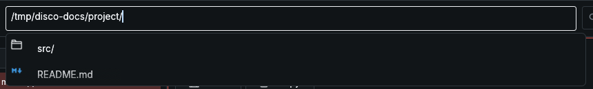

Click a breadcrumb to navigate, or **…** for hidden ancestors. Back/forward, Backspace and mouse side buttons follow navigation history. **Alt+Home** uses the Home path configured under Settings → Interface.

## Browse, scan and search filenames

Choose a folder with the drive/path control, then **Scan** to calculate folder sizes. You can pause or cancel. **F5 / Refresh** rereads the current scope/category; unrelated subtrees and drafts stay intact. A small spinner distinguishes loading a directory, restoring a snapshot and scanning.

The last complete scan is restored when enabled. **Each scanned root now keeps its own snapshot.** Scanning a small folder preserves wider and unrelated cached roots. Category/Home navigation selects a matching cached workspace in the background, preferring coverage and a more specific root. Independent scans are not combined into a fictional single scan; a category spanning unrelated roots may still have missing coverage. An unscanned tree offers Scan below its explanation. Choosing a category can load an existing snapshot without scanning. See [cache troubleshooting](investigations/cache-categories.md) if expected cached sizes are missing.

Filename search uses the selected folder/file parent, then the current directory/category roots, then configured Home if allowed. It expands only when the earlier level has no matches. The origin stays fixed while typing and selecting results; clear the query to begin from a new place. Search works in unexpanded and unscanned directories, with up to 2,000 displayed results. Status names the search area. Clearing a result outside the original tree reveals its directory without scanning.

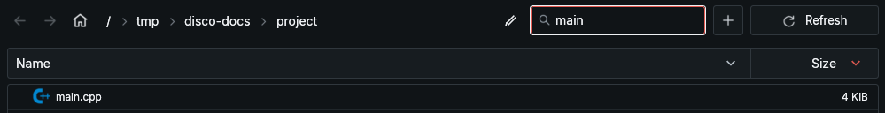

## Overview and Focus

| Layout | Use it for | Terminal |
| --- | --- | --- |
| **Overview** | Disk usage, folder sizes and properties | Below the tree |
| **Focus** | Folder tree, document tabs and code | Beside the document |

Title-bar icons switch layouts and toggle Terminal; hover for labels. Settings can restore text labels. Drag panel dividers to resize. The category rail uses theme-aware icons; names are optional.

## Tabs and editing

A tree click or keyboard selection reuses one italic **preview tab**. Select another file to replace that preview. **Click inside the document/image, edit it, or press Enter/→ in the tree to keep it.** Tree double-clicks do not pin it; they may launch the associated external application if enabled.

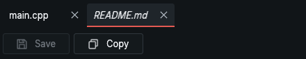

**Ctrl+Tab / Ctrl+Shift+Tab** switches existing tabs right/left in their visible order, wrapping at the ends. It does not use visit history or open extra files. Kept tabs retain drafts, cursor, scroll and session zoom. ×, middle-click or **Ctrl+W** closes a tab. Unsaved changes ask for Save / Discard / Cancel; up to 64 tabs can remain open.

**Ctrl+S** saves the active file. **Ctrl+Z** undoes actions: paste, Enter, cut and selection replacement have separate boundaries; ordinary typing/deletion may group. **Ctrl+Y / Ctrl+Shift+Z** redoes. Save, tab changes and Markdown mode changes preserve undo history.

### New files

**Ctrl+T** creates an in-memory tab without touching disk. The first **Ctrl+S** asks for a path; relative paths use the folder selected when the tab was created. Absolute paths are accepted; missing parent folders are created. Existing files are not overwritten. Cancel keeps the draft. Untitled tabs do not auto-save.

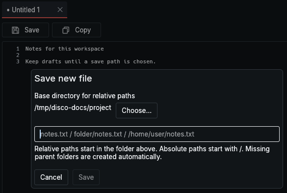

**Ctrl+N** creates a file directly; `nested/file.txt` creates missing parents. Unlike the first-save dialog, this older dialog treats a leading `/` as relative to the chosen folder.

### External tools and auto-save

The active file follows writes by terminal tools and coding agents, including atomic replacements. Clean text updates without a blank loading frame; cursor, selection, scroll and zoom are preserved where possible. This works without category live updates or rescanning. **A dirty local draft is kept with a conflict warning**, not silently replaced.

Auto-save is off by default. Enable it per category, or for All folders in Interface settings. It saves after one second without typing, including inactive tabs. A category’s **Read-only** blocks disco edits, saves, creation and deletion; it does not restrict shell commands or OS permissions. Saves preserve encoding, BOM, line endings, permissions and extended attributes.

## Find and zoom

In **Focus**, **Ctrl+F** searches the active file’s current text, including unsaved edits. It floats over the editor without moving its text. A single-line selection seeds the query. **Aa** toggles case sensitivity; the counter shows current/total matches.

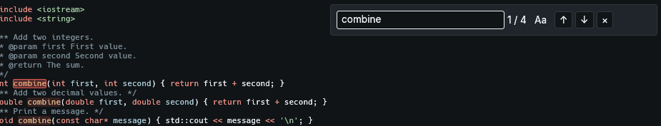

**Enter / Shift+Enter** in the find field and **F3 / Shift+F3** navigate forward/backward, wrapping. **Escape / ×** closes. Closing clears the query by default; enable **Remember query after closing file search** under Interface to retain it per open tab for this session. Matching is literal, not regex. Markdown find opens its source; truncated previews search only loaded text. In Overview, Ctrl+F focuses filename search; a focused terminal keeps its own Ctrl+F.

Focus a document and use **Ctrl+Plus / Ctrl+Minus** (Ctrl+= also works), or **Ctrl+wheel over its content**. The default step is **10 percentage points**, configurable under Interface → File zoom step. **Ctrl+0** resets; remap Reset file zoom under Shortcuts. The bottom status bar also has −, percentage/reset and + controls. Text/Markdown: 50–300%; images: 25–800% of Fit. Zoom belongs to the tab for the session, separately from UI/sidebar text size.

## Markdown

`.md` / `.markdown` opens in **Read** mode. Switch **Read / Edit** in the document toolbar without saving or losing the draft, cursor or undo history.

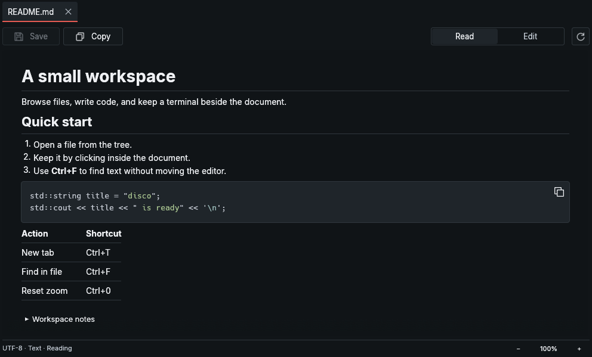

Read mode supports headings, lists, tables, quotations, links, heading anchors, local raster images and expandable `details` / `summary`. Code blocks show their full height, wrap long lines and have a copy button. Missing images show alt text; remote images are not fetched. Clicked local file links open in disco. Markdown zoom uses the same bottom controls.

## Code completion (LSP)

Enable a language server to add completion, descriptions, diagnostics and parameter help. Syntax highlighting alone does not enable suggestions. See the illustrated **[LSP setup and usage guide](language-servers.md)**, including a ready-to-open C++ example.

The important distinction: a grouped completion’s overload count is only a count. Accept the name, type **`(`**, then use **‹ / ›** or **Alt+← / Alt+→** in the signature panel. **Ctrl+Shift+Space** requests that panel manually.

## Terminal

Click the title-bar terminal icon or **Ctrl+Alt+T**. It starts your shell in the selected folder/file parent. Later browsing does not change that shell’s directory.

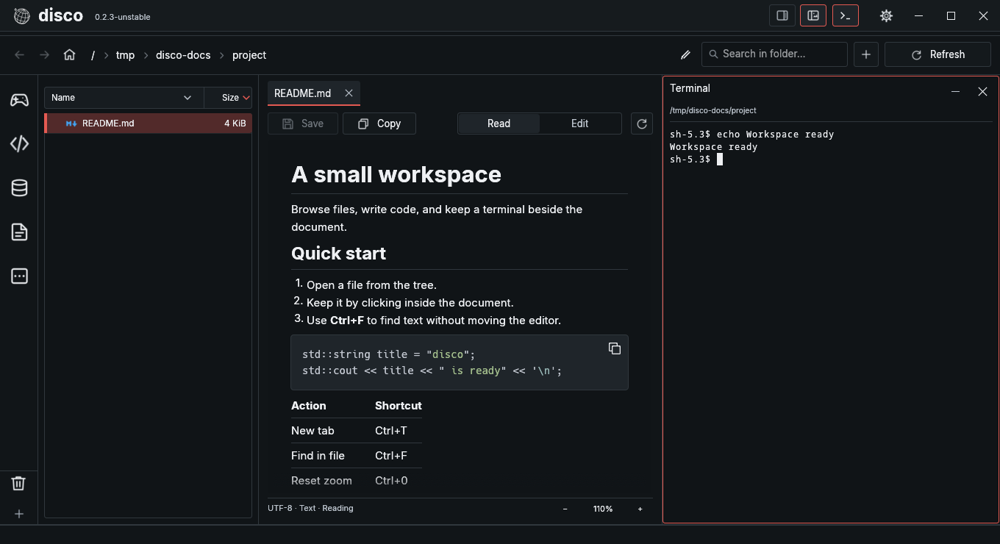

**–** or the toggle hides the panel while keeping its session; **×** ends the shell and session processes. Switching layouts keeps the same session. Drag the divider to resize; closing disco ends it. Terminal is hidden in Trash.

**Ctrl+Shift+C / V** copies/pastes; **Ctrl+C** interrupts the running program. While the terminal has focus, ordinary editor keys go to it. **Ctrl+Alt+arrows** moves panel focus: Focus terminal ← returns to the document; Overview terminal ↑ returns to files, → enters properties. The terminal uses your installed shell/programs and theme colors.

## Themes and settings

**Ctrl+,** opens one separate settings window. Save applies the draft; Cancel, Escape or close restores it. Settings do not discard the main document.

Appearance offers five dark presets (**Carbon, Ember, Noir, Midnight, Forest**) and four light presets (**Paper, Cairo, Glacier, Soft Rose**). The swatch shows each accent. The picker scrolls five rows at a time; **Create new…** stays below it. Name the theme, edit colors and Save; Cancel creates no files.

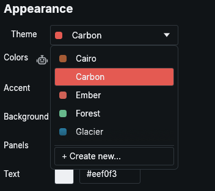

The **robot button** opens a theme-generation prompt with the actual paths, catalog and color schema. Copy it to an assistant and append your desired colors/mood. It includes instructions for assistants without PC access. After external edits, **Reload themes**, then Save. Invalid files show an explanation; external changes made while Settings was open are not silently overwritten.

<details>
<summary>Theme prompt and Soft Rose examples</summary>

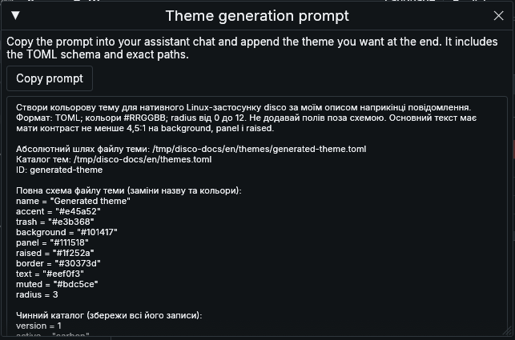

The screenshot deliberately uses Ukrainian prompts in an English UI; prompt language is independent when enabled.

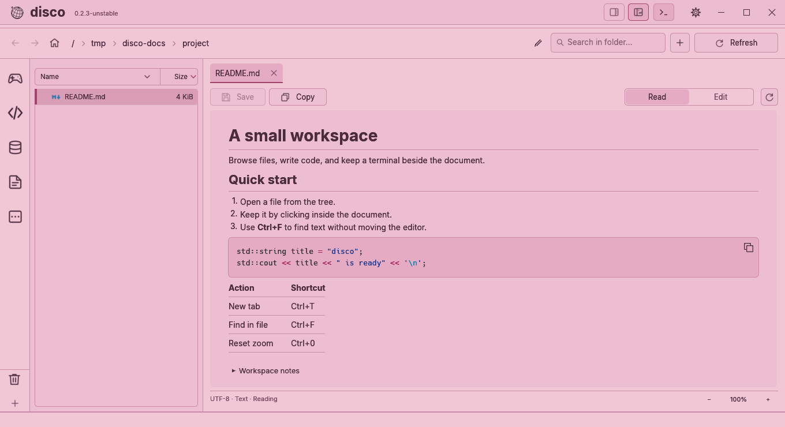

</details>

### Language, icons and independent scales

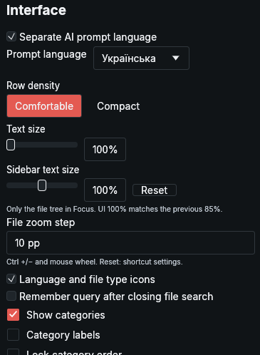

AI prompts follow the UI language by default. Check **Separate AI prompt language** to reveal an independent Ukrainian/English selector for category and theme prompts. The robot prompt is copied text; disco does not send it to an AI service.

**Text size** controls the UI; its new 100% equals the old 85%. **Sidebar text size** independently scales the Focus tree from 80–120%; nested indentation is 8 px. Document zoom remains separate.

Enable **Language and file type icons** for bundled symbols covering 59 language/format families, including C/C++, Rust, JS/TS, JSON/YAML/TOML. Dockerfile, Makefile and common dotfiles are recognized. Unknown files and images retain generic icons. It defaults off; no icon downloads occur.

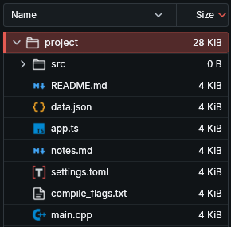

### Shortcuts

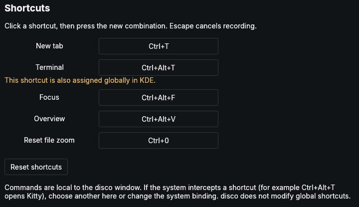

Under Shortcuts, click a field and hold modifiers, then press the main key. **Ctrl+Alt alone is not a shortcut.** Ctrl/Alt/Shift combinations are supported. Escape cancels recording; Reset restores defaults. Conflicts and KDE global assignments are indicated. Desktop shortcuts may intercept keys before disco; disco does not change system assignments.

## Categories, live folder updates and Trash

Settings → Categories creates collections with absolute folder paths and built-in/imported artwork. Right-click a category to add selected folders. Drag categories to reorder; **Lock category order** prevents movement. Removing a category/path never deletes its files. The category robot prompt describes its schema and can help an assistant choose folders.

Enable **Live file updates** per category to track the active folder scope. It is off by default and separate from active-document reload. Changes refresh affected directories; watch/access errors appear in status. There is no permanent indexing service. Collections may overlap; nested roots are counted once.

The bottom-left **···** menu opens Large files, Cleanup and Duplicates. Delete asks before moving items to **Trash**. Trash supports Restore, permanently remove selected, and Empty; permanent removal asks again. Its refresh reconciles only Trash and free disk space, without replacing the folder snapshot.

## Configuration and limits

| Location in the normal profile | Purpose |
| --- | --- |
| `~/.config/disco/layout.toml` | Language, layout, scales and shortcuts |
| `~/.config/disco/themes.toml`, `themes/<id>.toml` | Theme index/active ID and separate color files |
| `~/.config/disco/categories.toml`, `categories/*.toml` | Category index and individual collections |
| `~/.config/disco/lsp.toml` | Language-server catalog |
| `~/.cache/disco/last-scan.bin.gz` | Last workspace, retained for startup/compatibility |
| `~/.cache/disco/scans/<root-hash>/` | Independent snapshots and root metadata |

`XDG_CONFIG_HOME` / `XDG_CACHE_HOME` are supported. An installation using `--config-dir ~/.config/disco-unstable` has a **separate profile/cache**; the app is still named disco. Do not mistake a different profile for erased data. See the [theme catalog](../assets/themes.toml), [color file](../assets/themes/paper.toml) and [category schema](../categories.example.toml). Legacy `theme.toml` is retained as a migration backup. Keep imported `icons/` when sharing categories.

Text preview: UTF-8 or UTF-16 with BOM, up to **128 KiB / 2,000 lines**; truncated fragments are read-only. Images: PNG/JPEG/WebP/BMP/TIFF, up to **32 MiB / 12 megapixels**, retained at up to 2048 px. Unsupported content explains its limit. Scans use allocated blocks, stay on one filesystem and do not follow symlinks. Terminal compatibility depends on the running program.

## Keyboard reference

| Keys | Action |
| --- | --- |
| ↑ / ↓, Home / End, Page Up / Down | File-list navigation |
| → / ←, Enter | Expand/collapse; keep/focus a preview; enter a folder |
| Ctrl+T / Ctrl+N / Ctrl+S | Untitled tab / create file / save |
| Ctrl+W | Close the active tab safely |
| Ctrl+Tab / Ctrl+Shift+Tab | Next / previous visible tab |
| Ctrl+L | Edit address |
| Ctrl+F, F3 / Shift+F3 | Find in Focus; next/previous match |
| Ctrl+Plus / Minus, Ctrl+wheel, Ctrl+0 | File zoom / reset |
| Ctrl+Space / Ctrl+Shift+Space | Completion / parameter help |
| Alt+← / → in signature help | Inspect overloads |
| Ctrl+Alt+F / V / T | Focus / Overview / Terminal defaults |
| Ctrl+Alt+arrows, F6 / Shift+F6 | Move focus between panels |
| F5 / Alt+Home / Ctrl+, | Refresh / configured Home / Settings |
| Ctrl+Shift+C / V in terminal | Copy / paste |

Screenshots show native 0.2.3-unstable UI with demonstration data, captured on a private virtual display. [Docker build](docker.md) · [Development](development.md) · [Changelog](../CHANGELOG.md).
