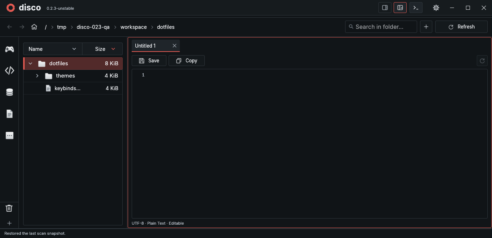
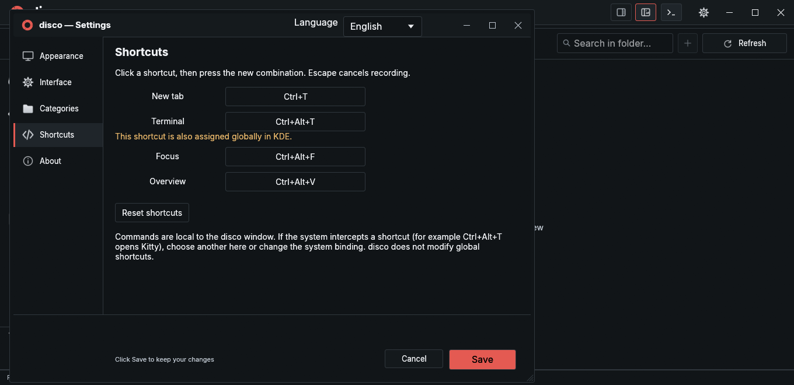

# User guide

[← README](../README.md) · **English** / [Українська](guide.uk.md)

## Browse and scan

Click the drive name to select a folder, then Scan. A scan can be paused or cancelled. The last complete snapshot is saved and restored on startup; **F5 / Refresh** rereads the current folder scope or active category roots. Unrelated subtrees, expanded folders and unsaved text are retained.

Sizes reflect allocated disk blocks. Scans do not follow symbolic links and stay on one filesystem. Restored results are a snapshot, not a claim that every file is unchanged.

Click folders to expand them; Enter enters a folder. Breadcrumbs follow the selected folder or the selected file's parent. Click a component to navigate, or **…** to reach hidden ancestors. Navigation buttons, Backspace and mouse side buttons move through history. Home uses `/home`, falling back to `/`; change it under Settings → Interface → Panels, Home & search.

Search includes files and folders in the current scope. Clicking a folder result enters it and clears the query; subsequent searches use that scope. Optional Home fallback runs after no scope results. Results are cancellable and limited to 2,000 displayed items. See [current limitations](#current-limitations) for the open search bug.

## Overview and Focus

| Layout | Use it for | Resize |
| --- | --- | --- |
| Overview | Disk usage, sizes, preview and file properties | Drag the left edge of properties |
| Focus | A folder tree and tabbed document, without the SSD header or properties | Drag the tree/document divider |

The title-bar buttons switch layouts and remember your choice. The category rail uses icons by default; hover for names, or enable labels in Settings → Interface.

## Terminal

Click **Terminal** beside the layout buttons. It starts your system shell in the selected folder or selected file's parent. Later browsing leaves that running shell's directory unchanged.

| Control | Result |
| --- | --- |
| Title-bar Terminal button or header **–** | Hide the panel, keeping its session and output |
| Header **×** | End the shell and its session processes; free the panel |
| Open after closing | Start a fresh session |
| Change layout | Move the same running session |
| Close disco | End the terminal session |

Overview docks the terminal below categories and files, keeping properties at full height. Drag the terminal's top divider to adjust height. Focus docks it on the right; drag its left edge to adjust width. The terminal is hidden in Trash.

### Terminal keyboard routes

All panel routes below use **Ctrl+Alt** with an arrow. Plain arrows remain terminal input.

| Starting panel | Overview | Focus |
| --- | --- | --- |
| Categories or file list | ↓ enters the terminal | Navigate through tree/document toward the right |
| Terminal | ↑ files; → properties; ←/↓ stay in place | ← document; other directions stay in place |
| Properties / document | ← terminal | → terminal, when visible |

**Ctrl+Shift+C / Ctrl+Shift+V** copy and paste. **Ctrl+C** interrupts a process. Enter, Delete, Ctrl+S, Ctrl+N and Ctrl+W inside the terminal are shell input and do not trigger file actions.

The PTY uses the Alacritty terminal engine with native egui rendering. Terminal colors follow the app theme; system monospace and symbol fonts are loaded on first use. A launcher-inherited `NO_COLOR` is cleared only for the PTY subprocess. Shell configuration remains your own. Compatibility and implementation notes: [development guide](development.md#terminal).

## Untitled text tabs (0.2.3 preview)



**Ctrl+T** opens a blank text tab in Focus without creating anything on disk. Type or paste normally. Multiple untitled tabs keep independent buffers; closing a modified tab or the app asks before discarding it. Untitled buffers do not auto-save until you choose a file path.

The first **Ctrl+S** opens Save new file. The proposed base is the folder selected when the tab was created, or a selected file's parent; otherwise it uses the current scope root. Selecting `/workspace/dotfiles` therefore proposes that folder, not `/workspace`.

| Input | Result with base `/workspace/dotfiles` |
| --- | --- |
| `notes.txt` | `/workspace/dotfiles/notes.txt` |
| `nested/notes.txt` | `/workspace/dotfiles/nested/notes.txt` |
| `../notes.txt` | `/workspace/notes.txt` |
| `/tmp/notes.txt` | `/tmp/notes.txt` |

Paste paths into the field, or choose a different base folder. Missing parent folders are created. Existing files are never overwritten, and symbolic parent directories are not followed. Invalid paths or write errors retain the dialog, input focus and draft. Cancel returns to the buffer. After saving, the tab becomes a normal named document; subsequent Ctrl+S saves it directly.

This Save As dialog uses standard absolute-path semantics. The older **Ctrl+N** file-creation dialog retains its existing rule that a leading `/` stays relative to the chosen folder.

## Preview, edit and keep tabs

Select a file to preview it. Images preserve their proportions and support fit/zoom; portrait images use a taller canvas. Double-click opens an installed default application, when one is associated. Disable double-click opening under Settings → Interface → Default file view.

Complete text files open in an editor with background syntax highlighting from syntect and bat/two-face grammars. **Ctrl+S** saves while keeping the editor focused. Clicking below a short document places the cursor at its end. Scrolling over the text stays within the document, including at the top and bottom.

In Focus, keyboard file browsing reuses one italic temporary tab:

1. Enter or → retains the preview. Editing also retains it.
2. On a retained file, → focuses the document; Enter launches its default application, if available.
3. Retained tabs keep their drafts, cursors and scroll positions when changing files or categories.

Mouse selections open retained tabs. × or middle-click closes one; Ctrl+W closes the active tab. Unsaved text asks for Save / Discard / Cancel before leaving or closing, including inactive drafts when closing the app. Up to 64 tabs can remain open; only the visible image keeps a decoded texture.

### Auto-save and read-only categories

Auto-save defaults to off. Enable it per category, or for All folders under Settings → Interface → Panels, Home & search. It writes after one second without typing, including inactive tabs. External changes preserve a dirty draft rather than overwrite the disk; a failed save shows an error without endless retries.

A category's read-only policy prevents editing, saving, creating and deleting inside disco. Previewing and copying remain available. It does not change operating-system permissions or commands run in a terminal.

Saves preserve encoding, BOM, line endings, permissions and extended attributes. Text fragments from large files remain read-only.

### Preview limits

| Content | Supported formats | Limit |
| --- | --- | --- |
| Images | PNG, JPEG, WebP, BMP, TIFF | 32 MiB, 12 megapixels; retained preview up to 2048 px |
| Text | UTF-8; UTF-16 with BOM | 128 KiB / 2,000 lines |

Selected content is read in the background. Unsupported or oversized content shows an explanation. Expanded file listings are separately cached and bounded; truncated listings are labeled.

## Categories

Settings → Categories lets you create or rename a collection, choose from 38 SVG icons or import an SVG/PNG/JPEG/WebP, and add absolute folder paths. Right-click a category to add selected folders. Save applies changes; Cancel discards them. Removing a collection or a path leaves its data intact.

Drag categories to reorder them. Trash stays at the bottom. Enable **Lock category order** under Interface to prevent movement.

Collections can overlap. Nested roots within a collection are counted once. A built-in category with no explicit folders uses automatic rules; assigning folders replaces those rules. Sizes come from the current scan. An unscanned path offers Scan; scanning it replaces the current snapshot. For multiple roots on one filesystem, scan their common parent.

### Category files

The shared index is `~/.config/disco/categories.toml`:

```toml
version = 2
files = ["categories/photos.toml"]
```

Each entry points to a separate category document, for example `categories/photos.toml`:

```toml
version = 1
id = "photos"
name = "Photography"
icon = "camera"
folders = ["/home/user/Pictures"]
auto_refresh = false
auto_save = false
read_only = true
```

See the [full example](../categories.example.toml). Existing single-file lists migrate with a `.bak` backup. Valid external edits reload while Settings is closed; invalid input keeps the last valid configuration. Conflicting edits are not silently overwritten.

The robot button in the category editor copies an agent prompt in the interface language, with the category's path and schema. Paste it into an agent with PC access to find folders. disco itself makes no AI or network requests for this action.

Imported icons are stored in `~/.config/disco/icons/`. SVGs retain vector rendering; raster imports are bounded to 256 px. Imports accept up to 2 MiB and do not load external or embedded SVG images. Keep the icons directory when sharing a configuration.

## Live updates

Enable **Live file updates** per category in Settings. It defaults to off and watches only the active category/scope while disco runs. The first activation synchronizes that scope.

Filesystem events are coalesced: an ordinary file change rereads its parent folder, with new directories added after discovery. Watch-limit and access errors appear in the status bar. Clean documents reload while keeping the cursor; dirty drafts retain their conflict protection. No permanent disk indexing service is installed.

## Cleanup and Trash

The bottom-left **···** menu opens Large files, Cleanup and Duplicates. Delete in the list, or Delete folder in properties, asks for confirmation before moving data to Trash.

Trash supports restoring selected items, permanently removing selections and emptying the bin. Permanent deletion requires a separate confirmation. The drive bar shows Trash as an amber part of used space, plus an item count; it is not added to used space twice. Click that label to open Trash.

After restore or permanent removal, disco automatically rereads only Trash and samples free disk space. It does not rescan the folder tree or replace your current scan snapshot. Successfully removed items disappear immediately, and unchanged Trash directory totals are reused. **Refresh / F5** inside Trash also stays within this scope. Folder-tree results remain a snapshot until that scope is refreshed separately.

A failed or partially completed action still triggers reconciliation. Remaining items stay visible; unreadable contents are shown as unavailable, not as an empty bin. A restore collision can show an action error while the readable listing and its totals remain valid.

## Settings and files

Settings open in one separate, resizable window. Reopening raises it with its draft intact. Save persists changes; Cancel, Escape or closing restores the previous configuration. Your main file draft and folder context remain intact.

Under Interface, **Text size** uses a new 100% baseline equal to the previous 85%. Existing layouts keep their actual size through a one-time migration. **Sidebar text size** (80–120%) independently resizes the Focus tree; its Reset button restores 100%. It does not resize your document or terminal. Nested folders use compact 8 px indentation and truncate long names before the size column; hover for the full path.

Appearance includes five dark themes (Carbon, Ember, Noir, Midnight, Forest) and four light ones (Paper, Cairo, Glacier, Soft Rose). The rounded swatch before each name shows its accent. The picker shows up to five theme rows at a time; **Create new…** stays pinned below the scrolling list. Give a new theme a name, edit its colors and click Save. Cancel discards pending themes and color changes without creating files.

The robot button opens an editable theme-generation prompt with the full color schema, actual configuration paths and the existing theme catalog. Copy it to your assistant and append the colors or mood you want. It tells assistants with PC access to create and register the theme; assistants without access must return the file and exact placement commands. Prompts currently follow the interface language. After external changes, click **Reload themes**, then Save. Invalid theme files are disabled with an explanation on hover; other themes remain available. Disco refuses to overwrite external theme changes made while Settings was open.

| File | Purpose |
| --- | --- |
| `~/.config/disco/themes.toml` | Theme index and active theme ID |
| `~/.config/disco/themes/<id>.toml` | Individual theme colors |
| `~/.config/disco/theme.toml` | Original legacy theme, retained as a migration backup |
| `~/.config/disco/layout.toml` | Language, sizes, layout and interface options |
| `~/.config/disco/categories.toml` | Category index |
| `~/.cache/disco/last-scan.bin.gz` | Last complete scan |

`XDG_CONFIG_HOME` and `XDG_CACHE_HOME` are supported. `language = "en"` / `"uk"` and `preview_mode = "overview"` / `"focus"` can also be edited in `layout.toml`.

Development builds are also installed as **disco**. To keep their separate configuration, use `python3 install.py --config-dir ~/.config/disco-unstable`; installation replaces the old disco Unstable launcher with one disco entry. The catalog contains `version = 1`, an `active` ID and `[themes.<id>]` entries with `name` and `file = "themes/<id>.toml"`. See the bundled [catalog](../assets/themes.toml) and [Paper color file](../assets/themes/paper.toml) for complete examples. Once migrated, edit the catalog/theme files rather than the old backup `theme.toml`.

## Custom shortcuts



Settings → Shortcuts records a combination when you click its field and press the keys. Escape cancels capture; Reset restores defaults. Save persists changes and Cancel restores the prior bindings. The new-tab default is Ctrl+T. Other defaults are Ctrl+Alt+T for the terminal, Ctrl+Alt+F for Focus and Ctrl+Alt+V for Overview. Conflicting app bindings and reserved editor/navigation commands are rejected. KDE global assignments are highlighted: a compositor shortcut may intercept the key before disco receives it; reassign it in disco or system settings. No global shortcuts are modified.

## Keyboard reference

| Keys | Action |
| --- | --- |
| ↑ / ↓, Home / End, Page Up / Down | Move through the file list |
| → / ← | Expand/collapse folders; retain/focus a Focus file |
| Enter | Enter a folder; retain/open a Focus file |
| Backspace | Go back, otherwise select the parent |
| Delete | Move selection to Trash after confirmation |
| Ctrl+N | Create a file; `new_folder/file.txt` also creates parents |
| Ctrl+S | Save without leaving the editor |
| Ctrl+Tab / Ctrl+Shift+Tab | Next / previous visible file, skipping folders |
| Ctrl+F / F5 | Search / refresh current scope |
| Alt+Home | Open configured Home |
| Ctrl+Alt+arrows | Move between panels |
| F6 / Shift+F6 | Cycle panels without inserting an editor tab |
| Ctrl+comma | Open or raise Settings |
| Ctrl+W | Close active Focus tab |
| Ctrl+Shift+↑ / ↓ in categories | Reorder the selected category, when unlocked |
| Tab / Shift+Tab, Space / Enter, Escape | Operate controls and dialogs |

File-list shortcuts do not run while typing in text fields. Ctrl+Tab follows visible file-list order, not tab order, and stops at the ends. System clipboard shortcuts work in editable fields. New-file input keeps focus after an invalid path and never overwrites an existing file; a leading `/` remains relative to the selected folder.

## Current limitations

- Search does not yet reliably follow the requested selected-folder → category → Home priority. Improving file results and scope selection is tracked for a later update.
- The integrated terminal is a native embedding of an adapted widget, not a promise of compatibility with every terminal application. LSP/code completion is not included.

In Focus, clicking files in the tree reuses one temporary tab. Click inside its document or image to keep it open; tree double-clicks do not pin it. Enter/Right-arrow keyboard actions still keep the preview. Unsaved documents remain protected.

AI prompts follow the application language by default. Enable **Separate AI prompt language** in Settings → Interface to reveal the Ukrainian/English selector. This applies to both category and theme prompts; Save/Cancel cover both settings.

Markdown (`.md`/`.markdown`) opens in **Read** mode. Use **Read / Edit** in the same document to switch without saving or losing your draft, undo history or cursor. Read mode supports tables, lists, quotations, highlighted code, relative local raster images, links and heading anchors. Remote images are not fetched. Links open only when clicked; local files open in disco. Read-only categories still prevent edits. Text previews keep the existing 128 KiB bound; larger documents show the bounded beginning.

File zoom: focus the document and use Ctrl+Plus (or Ctrl+=) / Ctrl+Minus, or hold Ctrl and scroll over its content. Text and Markdown zoom from 50–300%; images from 25–800% of Fit. Click the percentage to reset. Zoom stays with each open Focus tab for the session; it changes neither the UI/sidebar nor file contents. Terminal and other text fields keep their keys.

Open one file or folder directly with `disco file.txt` or `disco /path/to/folder` (relative paths use the launching directory; `--` allows names beginning with a dash). A direct file opens in Focus with only that file in the left tree and no category rail or disk scan. Open a folder to use it as the workspace root. Ctrl+L or the pencil beside the breadcrumbs edits the address; Ctrl+F focuses filename search. Suggestions include folders and files, including hidden entries; use arrows, Enter to open, Tab to complete, or Esc to cancel. Relative address paths use the current folder; `~/` uses your home. Explicit symlinks resolve to their target. Completion is bounded and runs off the UI thread; unsaved documents keep the Save/Discard/Cancel guard.

Settings → Interface → **Language and file type icons** enables bundled SVG symbols for 59 language/format families (C/C++, Rust, JavaScript/TypeScript, Java, Python, Go, JSON/YAML/TOML and more). The default is off. Names/extensions are matched without case; Dockerfile, Makefile and common dotfiles are recognized. `.h` uses C, `.hpp` uses C++, `.m` uses Objective-C. Unknown files and images keep their generic symbols; custom category artwork is unaffected. Save/Cancel apply normally. Colors are slightly darkened on light themes for legibility; there are no runtime downloads.

File zoom changes by 10 percentage points by default. Set a custom step under Settings → Interface → File zoom step. Ctrl+0 restores 100%; remap Reset file zoom in Shortcuts. An existing Ctrl+0 assignment is preserved, with a free reset shortcut selected during migration.

Direct-file windows respect Show categories. Home and breadcrumbs reuse an existing snapshot, or read only the selected directory if it is outside the snapshot. Unknown folder sizes show —. Scan calculates recursive sizes explicitly; navigation keeps open tabs and drafts.

Document controls use one toolbar: Save/Copy on the left, Markdown Read/Edit on the right beside Reload. Narrow panels use icon actions and shorter mode labels. Zoom out, percentage reset (Fit for images) and zoom in are in the bottom status bar; full document status is available on hover.

### Reading Markdown

The reader uses a separate heading hierarchy, bundled Inter bold, a true monospace code face and physical pixel-aligned font sizes. The active theme controls surfaces and link colors. Tables have bold headers and subtle row rules.

Code blocks grow to their full height and wrap long lines; scroll the document rather than an inner code pane. The vector Copy code button copies the selected code, or the entire block when nothing is selected. `<details>` / `<summary>` sections use native disclosures and render their body only when opened; `open` and nesting are supported up to eight levels. Other HTML remains literal text, without a browser or scripts. Missing local images show their alt text; remote images still require no automatic network requests.

These are preview-only changes: Read/Edit keeps the original Markdown, draft and undo history. Use file zoom for a larger or smaller reading view.

After opening a standalone file, choosing a category or Home loads an existing saved snapshot in the background. This reads cached sizes without starting a new scan, preserves the selected category and keeps the document, draft, cursor and undo state. If no snapshot is available, Scan appears below the explanation inside the empty file tree. A small spinner indicates loading. Explicit scanning and a newly opened path take priority over an older cache request.

The active document automatically follows changes made by Codex, terminal tools or other programs, including atomic saves. This works for standalone CLI files and with category auto-refresh disabled; no folder rescan or cache write is required. Clean buffers reload after a short debounce while retaining the tab, cursor and zoom. Unsaved local edits are kept with a conflict warning; Save cannot silently overwrite an externally replaced file. Once local edits are undone/discarded, the clean buffer can follow the disk again. Hiding or closing the terminal does not disable this behavior.
