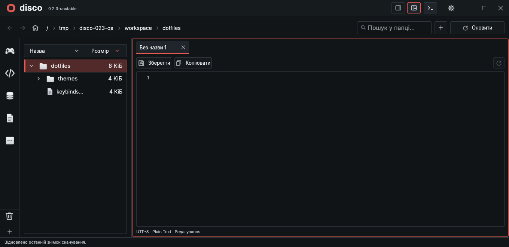
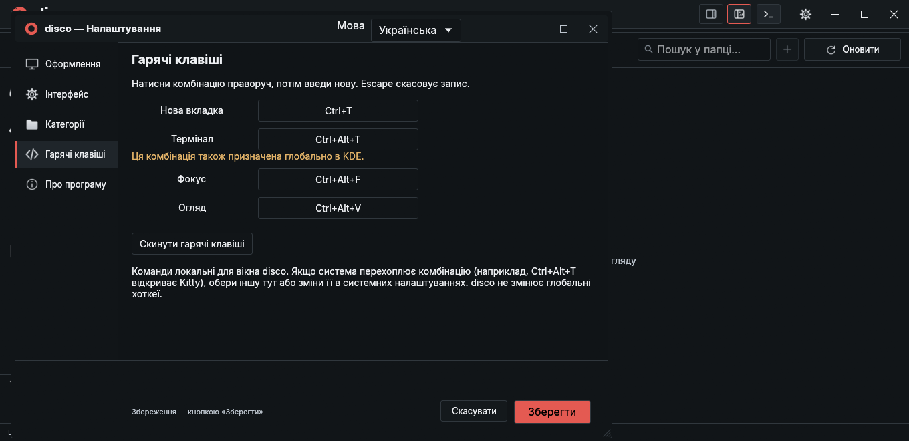

# Посібник користувача

[← README](../README.uk.md) · [English](guide.md) / **Українська**

## Навігація та сканування

Натисни назву диска, вибери папку та запусти сканування. Його можна призупинити або скасувати. Останній повний знімок зберігається й відновлюється при запуску. **F5 / Оновити** перечитує поточний скоуп папки або корені активної категорії, залишаючи сусідні піддерева, розгорнуті папки та чернетки.

Розміри враховують зайняті блоки диска. Скан не переходить за символічними посиланнями й залишається в одній файловій системі. Відновлений результат — знімок, а не гарантія, що всі файли досі незмінні.

Клік розгортає папку, Enter переходить у неї. Шлях зверху відповідає вибраній папці або батьківській папці файла; компоненти клікабельні, приховані предки доступні через **…**. Кнопки навігації, Backspace та бічні кнопки миші працюють з історією. Home типово веде в `/home`, за його відсутності — у `/`; шлях задається в Налаштування → Інтерфейс → Панелі, Home та пошук.

Пошук охоплює файли й папки поточного скоупу. Натискання знайденої папки переходить у неї та очищує запит. Опційний пошук у Home запускається за відсутності результатів. Задача скасовується при зміні запиту й показує до 2000 результатів. Відкритий баг із пріоритетами описано в [поточних обмеженнях](#поточні-обмеження).

## Огляд і Фокус

| Режим | Призначення | Зміна розміру |
| --- | --- | --- |
| Огляд | Зайняте місце, розміри, прев’ю й властивості | Перетягни ліву межу властивостей |
| Фокус | Дерево й документ у вкладках, без смуги SSD та властивостей | Перетягни межу дерева й документа |

Кнопки в заголовку перемикають режими та запам’ятовують вибір. Категорії типово показуються іконками. Назви доступні при наведенні або постійно через Налаштування → Інтерфейс.

## Термінал

Кнопка **Термінал** біля режимів відкриває системну оболонку у вибраній папці або батьківській папці файла. Подальша навігація не змінює директорію вже запущеної оболонки.

| Дія | Результат |
| --- | --- |
| Кнопка Термінал зверху або **–** у його заголовку | Ховає панель зі збереженням сесії та виводу |
| **×** у заголовку | Завершує оболонку та процеси сесії, звільняє місце |
| Відкриття після закриття | Створює нову сесію |
| Перемикання режимів | Переносить ту саму запущену сесію |
| Закриття disco | Завершує термінальну сесію |

В Огляді термінал знизу під категоріями й файлами, а властивості залишаються на повну висоту. Висоту змінює верхній розділювач термінала. У Фокусі термінал праворуч; ширину змінює ліва межа. У кошику панель прихована.

### Клавіатурні маршрути термінала

У таблиці всі стрілки використовуються з **Ctrl+Alt**. Звичайні стрілки залишаються вводом термінала.

| Початкова область | Огляд | Фокус |
| --- | --- | --- |
| Категорії або список файлів | ↓ у термінал | Рух через дерево й документ праворуч |
| Термінал | ↑ список; → властивості; ←/↓ залишають фокус | ← документ; інші напрямки залишають фокус |
| Властивості / документ | ← термінал | → видимий термінал |

**Ctrl+Shift+C / Ctrl+Shift+V** копіюють і вставляють, **Ctrl+C** перериває процес. Enter, Delete, Ctrl+S, Ctrl+N та Ctrl+W у терміналі надходять оболонці й не запускають файлові дії.

Використовується PTY із рушієм Alacritty й нативним малюванням egui. Кольори відповідають темі, системні моноширинні й символьні шрифти завантажуються при першому відкритті. Успадкований `NO_COLOR` прибирається лише в дочірньому PTY. Конфіг оболонки залишається твоїм. [Технічні подробиці](development.md#terminal).

## Незбережені текстові вкладки (прев’ю 0.2.3)



**Ctrl+T** відкриває порожню текстову вкладку у Фокусі без створення файла на диску. Можна писати й вставляти текст. Кілька вкладок мають незалежні чернетки; закриття зміненої вкладки чи програми потребує підтвердження. До вибору шляху автозбереження не записує чернетку.

Перше **Ctrl+S** відкриває «Зберегти новий файл». База — папка, вибрана при створенні вкладки, або батьківська папка вибраного файла; інакше поточний корінь. Для `/workspace/dotfiles` пропонується саме вона, а не `/workspace`.

| Ввід | Результат із базою `/workspace/dotfiles` |
| --- | --- |
| `notes.txt` | `/workspace/dotfiles/notes.txt` |
| `nested/notes.txt` | `/workspace/dotfiles/nested/notes.txt` |
| `../notes.txt` | `/workspace/notes.txt` |
| `/tmp/notes.txt` | `/tmp/notes.txt` |

Шлях можна вставити або обрати іншу базову папку. Вкладені папки створюються, наявні файли не перезаписуються; символічні посилання серед батьківських папок не обходяться. Помилка залишає діалог, фокус і чернетку. Скасувати повертає до тексту. Після запису вкладка стає звичайним документом, наступне Ctrl+S зберігає його напряму.

Цей діалог використовує звичайні абсолютні шляхи. Старий діалог **Ctrl+N** зберігає попереднє правило: початковий `/` залишається відносним до вибраної папки.

## Прев’ю, редагування та вкладки

Вибери файл для перегляду. Картинки зберігають пропорції, підтримують вписування й масштаб; вертикальні отримують вищу область. Подвійний клік запускає встановлену типову програму, якщо вона призначена. Це можна вимкнути в Налаштування → Інтерфейс → Стандартний вигляд файлів.

Повні текстові файли відкриваються в редакторі з фоновим підсвічуванням syntect і граматиками bat/two-face. **Ctrl+S** зберігає, залишаючи фокус. Клік під коротким документом переводить курсор у його кінець. Скрол над текстом залишається в документі навіть на верхній і нижній межі.

У Фокусі перебір клавіатурою використовує одну тимчасову вкладку курсивом:

1. Enter або → закріплює її. Редагування також закріплює перегляд.
2. Для закріпленого файла → переводить у документ; Enter запускає типову програму, якщо вона призначена.
3. Закріплені вкладки зберігають чернетки, курсор і прокрутку між файлами та категоріями.

Клік мишею відкриває закріплену вкладку. × або середня кнопка закриває її; Ctrl+W закриває активну. Незбережений текст захищає діалог Зберегти / Відкинути / Скасувати; при закритті програми перевіряються й неактивні чернетки. Доступно до 64 вкладок, декодована текстура зберігається лише для видимої картинки.

### Автозбереження й режим лише читання

Автозбереження типово вимкнене. Увімкни для окремої категорії або всіх папок у Налаштування → Інтерфейс → Панелі, Home та пошук. Запис виконується після секунди без набору, зокрема для неактивних вкладок. Конфлікт зі змінами на диску залишає чернетку, помилка показується без нескінченних спроб запису.

Режим лише читання блокує редагування, збереження, створення й видалення в disco. Перегляд і копіювання доступні. Ця політика не змінює права ОС і не обмежує команди термінала.

Запис зберігає кодування, BOM, завершення рядків, права й розширені атрибути. Фрагменти великих файлів залишаються лише для читання.

### Обмеження прев’ю

| Вміст | Формати | Межа |
| --- | --- | --- |
| Картинки | PNG, JPEG, WebP, BMP, TIFF | 32 МіБ, 12 мегапікселів; збережене прев’ю до 2048 px |
| Текст | UTF-8; UTF-16 із BOM | 128 КіБ / 2000 рядків |

Вибраний вміст читається у фоні. Завеликий або непідтримуваний файл показує пояснення. Списки розгорнутих папок мають окремий обмежений кеш; скорочені списки позначаються.

## Категорії

У Налаштування → Категорії можна створити чи перейменувати добірку, вибрати одну з 38 SVG-іконок або імпортувати SVG/PNG/JPEG/WebP та додати абсолютні шляхи папок. Правий клік по категорії додає вибрані папки. Зберегти застосовує зміни, Скасувати відкидає. Видалення категорії чи шляху не видаляє дані.

Перетягуй категорії для зміни порядку; кошик завжди внизу. Опція **Закріпити порядок категорій** в Інтерфейсі забороняє переміщення.

Добірки можуть перетинатися; вкладені корені всередині однієї рахуються один раз. Вбудована категорія без явних папок використовує автоматичні правила, а задані шляхи замінюють їх. Розміри беруться з поточного скану. Для невідсканованого шляху є Сканувати; це замінює знімок. Для кількох коренів однієї файлової системи скануй спільного предка.

### Файли категорій

Спільний індекс — `~/.config/disco/categories.toml`:

```toml
version = 2
files = ["categories/photos.toml"]
```

Кожен запис вказує на окремий документ, наприклад `categories/photos.toml`:

```toml
version = 1
id = "photos"
name = "Фотографії"
icon = "camera"
folders = ["/home/user/Pictures"]
auto_refresh = false
auto_save = false
read_only = true
```

Див. [повний приклад](../categories.example.toml). Старі однофайлові списки мігрують із резервною копією `.bak`. Коректні зовнішні зміни підвантажуються, коли налаштування закриті; помилка зберігає останній валідний стан. Конфлікти не перезаписуються мовчки.

Кнопка робота в редакторі категорій копіює промпт мовою інтерфейсу з її шляхом і схемою. Встав його агенту з доступом до ПК для пошуку папок. Сам disco для цього не робить AI- чи мережевих запитів.

Імпортовані іконки зберігаються в `~/.config/disco/icons/`. SVG залишаються векторними, растрові зменшуються до 256 px. Межа імпорту — 2 МіБ, зовнішні чи вбудовані SVG-картинки не завантажуються. При поширенні конфігу залишай каталог іконок.

## Автооновлення

Увімкни **Автооновлення файлів** для потрібної категорії в налаштуваннях. Типово вимкнене, стежить лише за активною категорією/скоупом під час роботи disco. Перше ввімкнення синхронізує цей скоуп.

Події файлової системи об’єднуються: звичайна зміна файла перечитує батьківську папку, нові директорії додаються після виявлення. Помилки доступу й ліміту спостерігачів видно в рядку стану. Чистий документ оновлюється зі збереженням курсора, незбережена чернетка захищена від конфлікту. Постійна служба індексації не встановлюється.

## Очищення й кошик

Меню **···** знизу ліворуч відкриває великі файли, очищення й дублікати. Delete у списку або Видалити папку у властивостях потребує підтвердження перед переміщенням у кошик.

У кошику можна відновити вибране, остаточно видалити його чи спорожнити все. Остаточне видалення має окреме підтвердження. Смуга диска позначає кошик жовтим як частину зайнятого місця та показує кількість елементів. Обсяг не додається вдруге; натискання підпису відкриває кошик.

Після відновлення чи остаточного видалення disco автоматично перечитує лише кошик і вільне місце диска. Дерево папок не сканується, основний знімок не замінюється. Успішно видалені елементи зникають одразу, розміри незмінних папок кошика беруться з кешу. **Оновити / F5** у кошику також працює лише в його скоупі. Дерево залишається знімком до окремого оновлення відповідної області.

Помилка чи часткове виконання теж запускає звірку. Невидалені елементи залишаються, непрочитаний вміст позначається як недоступний, а не порожній. Конфлікт відновлення може показувати помилку операції, не роблячи коректно прочитаний список і його лічильники недоступними.

## Налаштування й файли

Налаштування відкриваються в окремому вікні зі змінним розміром. Повторне відкриття піднімає його зі збереженням чернетки. Зберегти записує конфіг, Скасувати, Escape або закриття повертає попередній стан. Чернетка файла й контекст папок залишаються в основному вікні.

У розділі «Інтерфейс» нові 100% **масштабу тексту** відповідають попереднім 85%. Наявні налаштування зберігають фактичний розмір завдяки одноразовій міграції. **Текст бічної панелі** (80–120%) окремо змінює дерево у «Фокусі»; його кнопка «Скинути» повертає 100%. Текст документа й термінала від цього не змінюється. Відступ вкладених папок — 8 px, довгі назви обрізаються перед колонкою розміру; повний шлях видно при наведенні.

У «Оформленні» є п’ять темних тем (Carbon, Ember, Noir, Midnight, Forest) і три світлі (Paper, Cairo, Glacier). Закруглений квадратик перед назвою показує акцент. У списку видно до п’яти рядків тем; **«Створити нову…»** закріплена під прокручуваною частиною. Задай назву, відредагуй кольори й натисни «Зберегти». Скасування відкидає чернетки тем і кольорів без створення файлів.

Кнопка-робот відкриває промпт генерації теми з повною схемою кольорів, фактичними шляхами та чинним каталогом. Скопіюй його асистенту й допиши бажані кольори або настрій. Асистенту з доступом до ПК доручено створити й зареєструвати тему; без доступу — надати файл і точні команди розміщення. Поки промпти використовують мову інтерфейсу. Після зовнішніх змін натисни **«Оновити теми»**, потім «Зберегти». Пошкоджені файли тем недоступні з поясненням при наведенні; решта працюють. Зовнішні зміни, зроблені під час відкритих налаштувань, disco не перезаписує мовчки.

| Файл | Призначення |
| --- | --- |
| `~/.config/disco/themes.toml` | Каталог тем та ID активної теми |
| `~/.config/disco/themes/<id>.toml` | Кольори окремої теми |
| `~/.config/disco/theme.toml` | Попередня тема, збережена як резервна копія міграції |
| `~/.config/disco/layout.toml` | Мова, розміри, вигляд та опції інтерфейсу |
| `~/.config/disco/categories.toml` | Індекс категорій |
| `~/.cache/disco/last-scan.bin.gz` | Останній повний скан |

Підтримуються `XDG_CONFIG_HOME` та `XDG_CACHE_HOME`. У `layout.toml` можна задати `language = "en"` / `"uk"` та `preview_mode = "overview"` / `"focus"`.

Нестабільний launcher використовує окрему директорію конфігурації. Каталог містить `version = 1`, ID `active` та записи `[themes.<id>]` із `name` й `file = "themes/<id>.toml"`. Повні приклади: [каталог](../assets/themes.toml) і [кольори Paper](../assets/themes/paper.toml). Після міграції змінюй каталог/окремі файли тем, а не старий резервний `theme.toml`.

## Власні хоткеї



Налаштування → Гарячі клавіші записує комбінацію: натисни її поле й введи клавішами. Escape скасовує запис, Скинути повертає стандартні значення. Зберегти записує зміни, Скасувати повертає попередні. Типово Ctrl+T створює вкладку, Ctrl+Alt+T перемикає термінал, Ctrl+Alt+F — Фокус, Ctrl+Alt+V — Огляд. Дублікати й зайняті команди редактора/навігації відхиляються. Глобальні призначення KDE підсвічуються: система може перехопити клавіші раніше за disco; зміни комбінацію тут або в системі. Глобальні налаштування не змінюються.

## Клавіатурна довідка

| Клавіші | Дія |
| --- | --- |
| ↑ / ↓, Home / End, Page Up / Down | Рух списком файлів |
| → / ← | Розгорнути/згорнути папку; закріпити/сфокусувати файл у Фокусі |
| Enter | Зайти в папку; закріпити/відкрити файл у Фокусі |
| Backspace | Назад або вибір батьківської папки |
| Delete | У кошик із підтвердженням |
| Ctrl+N | Новий файл; `new_folder/file.txt` створює й батьківські папки |
| Ctrl+S | Зберегти без виходу з редактора |
| Ctrl+Tab / Ctrl+Shift+Tab | Наступний / попередній видимий файл, пропускаючи папки |
| Ctrl+L / F5 | Пошук / оновлення поточного скоупу |
| Alt+Home | Перейти в налаштований Home |
| Ctrl+Alt+стрілки | Перехід між панелями |
| F6 / Shift+F6 | Циклічний перехід без вставлення табуляції в текст |
| Ctrl+кома | Відкрити чи підняти налаштування |
| Ctrl+W | Закрити активну вкладку Фокусу |
| Ctrl+Shift+↑ / ↓ у категоріях | Змінити порядок вибраної категорії, якщо не закріплено |
| Tab / Shift+Tab, Space / Enter, Escape | Керування кнопками й діалогами |

Файлові скорочення не спрацьовують під час набору в полі. Ctrl+Tab слідує порядку видимих файлів, а не вкладок, і зупиняється на краях. Системні команди буфера працюють у текстових полях. Помилка нового шляху зберігає фокус; наявні файли не перезаписуються, початковий `/` залишається відносним до вибраної папки.

## Поточні обмеження

- Пошук ще не завжди відповідає бажаному пріоритету вибрана папка → категорія → Home. Результати файлів і вибір скоупу потребують окремого виправлення.
- Вбудований термінал використовує адаптований нативний віджет; сумісність з усіма термінальними програмами не гарантована. LSP і підказок коду поки немає.
