# Посібник користувача

[← README](../README.uk.md) · [English](guide.md) / **Українська**

Для **0.2.3-unstable**. [Відкриття шляхів](#відкрити-файл-або-проєкт) · [Вкладки й редагування](#вкладки-й-редагування) · [Пошук і масштаб](#пошук-і-масштаб) · [Markdown](#markdown) · [LSP](language-servers.uk.md) · [Теми](#теми-та-налаштування) · [Клавіші](#швидкі-клавіші)

## Відкрити файл або проєкт

```sh
disco README.md           # відносно поточної папки термінала
disco /path/to/project   # відкриття та сканування папки проєкту
disco -- ./-notes.txt    # назва, що починається з дефіса
```

Окремий файл відкривається у **Фокусі**, з файлом у лівому дереві. Панель категорій підкоряється опції «Показувати категорії». Відкриття файла не сканує його батьківську папку. Home і компоненти шляху використовують відомі розміри або читають лише вибрану папку; риска означає невиміряний розмір. Явне відкриття папки через CLI чи поле адреси запускає сканування проєкту.

**Ctrl+L** або олівець біля шляху вмикає редагування адреси. Пиши абсолютний шлях, `~/…` або відносний шлях від поточної папки. Підказки містять файли, папки й приховані елементи. ↑/↓ обирають, **Tab** доповнює, **Enter** відкриває, **Escape** скасовує. Файл стає документом; папка — поточним робочим каталогом із запуском сканування.

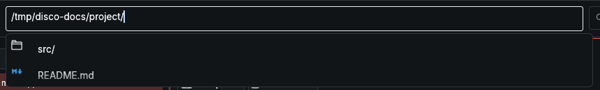

Компоненти шляху відкривають відповідні папки, **…** показує прихованих предків. Назад/уперед, Backspace та бічні кнопки миші переміщують історією. **Alt+Home** відкриває Home, заданий у Налаштування → Інтерфейс.

## Перегляд, сканування й пошук назв

Обери папку через назву диска/контроль шляху, потім **Сканувати**, щоб порахувати розміри. Сканування можна призупинити чи скасувати. **F5 / Оновити** перечитує поточну область/категорію; інші гілки й чернетки зберігаються. Маленький індикатор відрізняє читання папки, завантаження знімка та сканування.

Останній завершений знімок відновлюється, якщо це ввімкнено. **Кожен просканований корінь тепер має окремий знімок.** Скан маленької папки зберігає ширші й незалежні корені в кеші. Категорії/Home у фоні підбирають відповідний знімок за покриттям і точнішим коренем. Незалежні сканування не змішуються в один вигаданий скан: категорія з кількома непов’язаними коренями ще може мати неповне покриття. У непросканованому дереві кнопка Сканувати стоїть під поясненням. Вибір категорії може підвантажити наявний кеш без сканування. Якщо очікуваних розмірів немає, дивись [розбір кешу](investigations/cache-categories.md).

Пошук назв спочатку перевіряє вибрану папку/батька файла, потім поточний каталог або корені категорії, потім дозволений Home. Наступний рівень запускається лише без збігів на попередньому. Початкова область не змінюється від набору чи вибору результату; очисти запит, щоб почати з нового місця. Пошук працює і в нерозгорнутих/непросканованих папках, показує до 2 000 результатів. Статус називає область. Очищення запиту після вибору зовнішнього результату показує його папку без сканування.

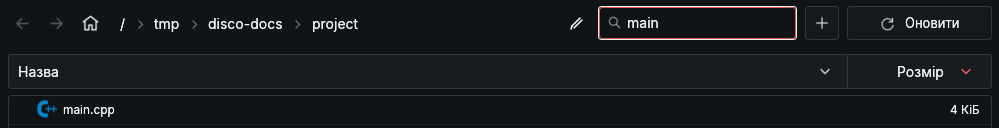

## Огляд і Фокус

| Режим | Для чого | Термінал |
| --- | --- | --- |
| **Огляд** | Диск, розміри папок, властивості | Під деревом |
| **Фокус** | Дерево, вкладки документів, код | Праворуч від документа |

Іконки в заголовку перемикають режими й термінал; назви видно при наведенні. Текстові підписи можна повернути в налаштуваннях. Перетягуй розділювачі для зміни розмірів. Іконки категорій враховують тему; назви необов’язкові.

## Вкладки й редагування

Клік у дереві або вибір клавіатурою використовує одну курсивну **тимчасову вкладку**. Вибір іншого файла замінює її. **Клікни всередині документа/зображення, почни редагування або натисни Enter/→ у дереві, щоб закріпити.** Подвійний клік у дереві не закріплює; він може відкрити типову зовнішню програму, якщо це дозволено.

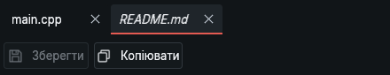

**Ctrl+Tab / Ctrl+Shift+Tab** перемикають наявні вкладки праворуч/ліворуч у видимому порядку, по колу. Історія відвідувань не впливає, нові файли не відкриваються. Закріплені вкладки зберігають чернетку, курсор, прокрутку й масштаб сесії. ×, середній клік або **Ctrl+W** закриває вкладку. Для незбережених змін є Зберегти / Відкинути / Скасувати; максимум — 64 відкриті вкладки.

**Ctrl+S** зберігає файл. **Ctrl+Z** скасовує дії: вставлення, Enter, вирізання та заміна виділення мають окремі межі; звичайний набір/видалення може групуватися. **Ctrl+Y / Ctrl+Shift+Z** повторює. Збереження, перемикання вкладок і режимів Markdown не скидає історію.

### Нові файли

**Ctrl+T** створює вкладку в пам’яті, не торкаючись диска. Перший **Ctrl+S** запитує шлях; відносний рахується від папки, вибраної під час створення вкладки. Абсолютні шляхи приймаються, відсутні батьківські папки створюються. Наявні файли не перезаписуються. Скасування зберігає чернетку. Безіменні вкладки не автозберігаються.

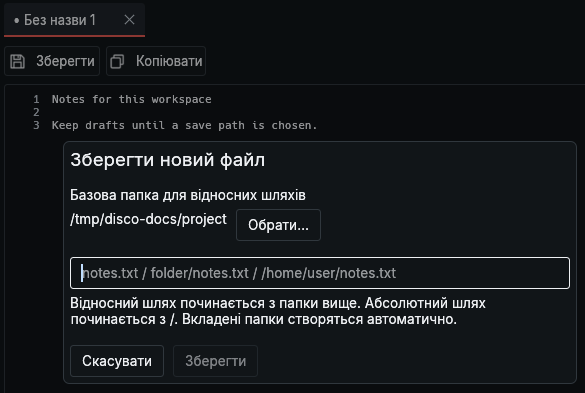

**Ctrl+N** створює файл одразу; `nested/file.txt` також створює батьківські папки. На відміну від першого збереження, цей старіший діалог трактує початковий `/` як шлях від вибраної папки.

### Зовнішні інструменти й автозбереження

Активний файл підхоплює зміни термінальних інструментів і агентів, включно з атомарною заміною. Чистий текст оновлюється без порожнього кадру; курсор, виділення, прокрутка й масштаб зберігаються, де можливо. Це працює без живого оновлення категорії та пересканування. **Локальна змінена чернетка залишається з попередженням про конфлікт**, а не зникає.

Автозбереження типово вимкнене. Увімкни його для категорії або «Всі папки» в Інтерфейсі. Воно записує через секунду без набору, зокрема неактивні вкладки. **Лише читання** забороняє редагування, збереження, створення й видалення через disco; права ОС і команди термінала не змінюються. Збереження підтримує кодування, BOM, закінчення рядків, права та розширені атрибути.

## Пошук і масштаб

У **Фокусі Ctrl+F** шукає в поточному тексті вкладки, включно з незбереженими правками. Панель плаває над редактором і не зсуває текст. Виділення в одному рядку підставляється в запит. **Aa** перемикає чутливість до регістру; лічильник показує поточний/загальну кількість збігів.

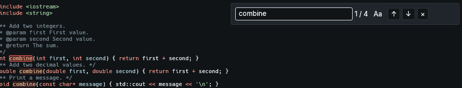

**Enter / Shift+Enter** у полі та **F3 / Shift+F3** перебирають збіги вперед/назад, по колу. **Escape / ×** закриває. Типово закриття очищає запит; опція **Пам’ятати запит після закриття пошуку** в Інтерфейсі залишає його для кожної відкритої вкладки на час сесії. Пошук буквальний, не regex. У Markdown відкривається джерело; у великому обрізаному файлі шукається лише завантажений текст. В Огляді Ctrl+F фокусує пошук назв; сфокусований термінал отримує власний Ctrl+F.

Сфокусуй документ і натискай **Ctrl+Plus / Ctrl+Minus** (Ctrl+= теж працює) або **Ctrl+коліщатко над вмістом**. Типовий крок — **10 процентних пунктів**, змінюється в Інтерфейс → Крок масштабу файла. **Ctrl+0** скидає; дію «Скинути масштаб файла» можна перепризначити в Гарячих клавішах. Унизу також є −, відсоток/скидання та +. Текст/Markdown: 50–300%; зображення: 25–800% від вписаного. Масштаб належить вкладці на час сесії, окремо від інтерфейсу й дерева.

## Markdown

`.md` / `.markdown` відкривається в **Читанні**. Перемикай **Читання / Редагування** в панелі документа без збереження чи втрати чернетки, курсора та Undo.

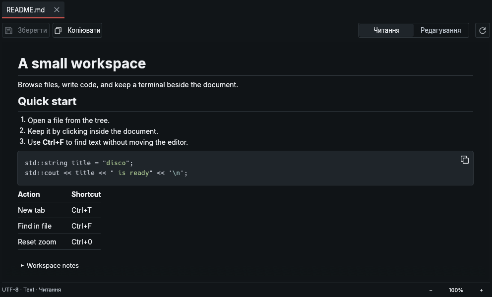

Підтримуються заголовки, списки, таблиці, цитати, посилання, якорі заголовків, локальні растрові зображення та розгортання `details` / `summary`. Кодові блоки мають повну висоту, переносять довгі рядки й мають кнопку копіювання. Відсутнє зображення показує alt-текст; віддалені зображення не завантажуються. Клік по локальному файловому посиланню відкриває його в disco. Масштаб Markdown керується тими самими кнопками внизу.

## Підказки коду — LSP

Увімкни мовний сервер для доповнення, описів, діагностики й довідки про параметри. Самі кольори синтаксису не вмикають підказки. Дивись наочний **[посібник із налаштування LSP](language-servers.uk.md)** з готовим прикладом C++.

Важлива різниця: число перевантажень у списку підказок лише рахує варіанти. Прийми назву, напиши **`(`**, тоді використовуй **‹ / ›** або **Alt+← / Alt+→** у панелі сигнатур. **Ctrl+Shift+Space** відкриває її вручну.

## Термінал

Іконка термінала в заголовку або **Ctrl+Alt+T** запускає твою оболонку в папці вибраного елемента. Подальша навігація не змінює каталог уже запущеної оболонки.

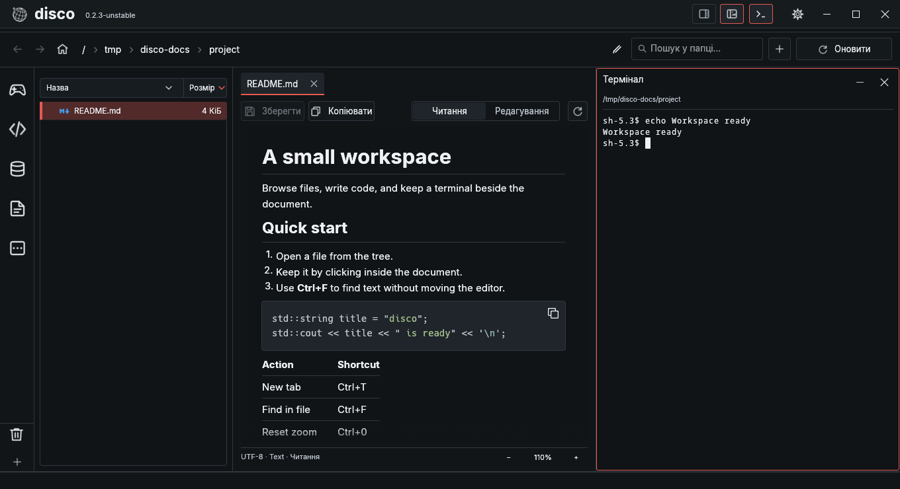

**–** або кнопка перемикання приховує панель зі збереженням сесії; **×** завершує оболонку та її процеси. Перемикання режимів зберігає сесію. Перетягуй розділювач для зміни розміру; закриття disco завершує термінал. У Кошику він прихований.

**Ctrl+Shift+C / V** копіює/вставляє; **Ctrl+C** перериває програму. Коли термінал сфокусований, звичайні клавіші редактора отримує він. **Ctrl+Alt+стрілки** змінює панель фокуса: з термінала у Фокусі ← повертає до документа; в Огляді ↑ до файлів, → до властивостей. Термінал використовує встановлені оболонку/програми й кольори теми.

## Теми та налаштування

**Ctrl+,** відкриває окреме вікно налаштувань. Зберегти застосовує чернетку; Скасувати, Escape чи закриття повертає попередні значення. Основний документ не втрачається.

Є п’ять темних пресетів (**Carbon, Ember, Noir, Midnight, Forest**) і чотири світлих (**Paper, Cairo, Glacier, Soft Rose**). Квадратик показує акцент. У списку видно до п’яти тем, **Створити нову…** завжди нижче нього. Назви тему, відредагуй кольори й збережи; Скасувати не створює файлів.

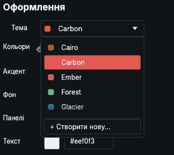

**Кнопка з роботом** відкриває промпт генерації теми зі справжніми шляхами, каталогом і схемою кольорів. Скопіюй асистенту й допиши бажані кольори/настрій. Є інструкції для асистента без доступу до ПК. Після зовнішніх правок — **Оновити теми**, потім Зберегти. Некоректні файли мають пояснення; зовнішні правки, зроблені під час відкритих налаштувань, не перезаписуються мовчки.

<details>
<summary>Приклади промпта теми й Soft Rose</summary>

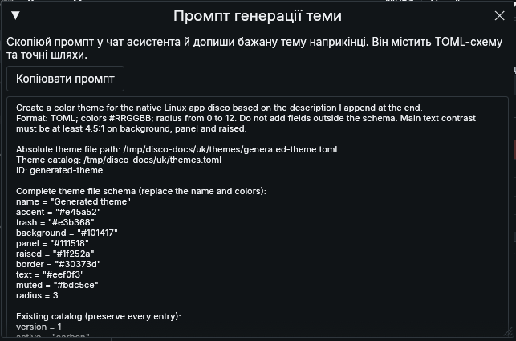

На скріні навмисно англійський промпт в українському інтерфейсі: після ввімкнення окремої мови ці значення незалежні.

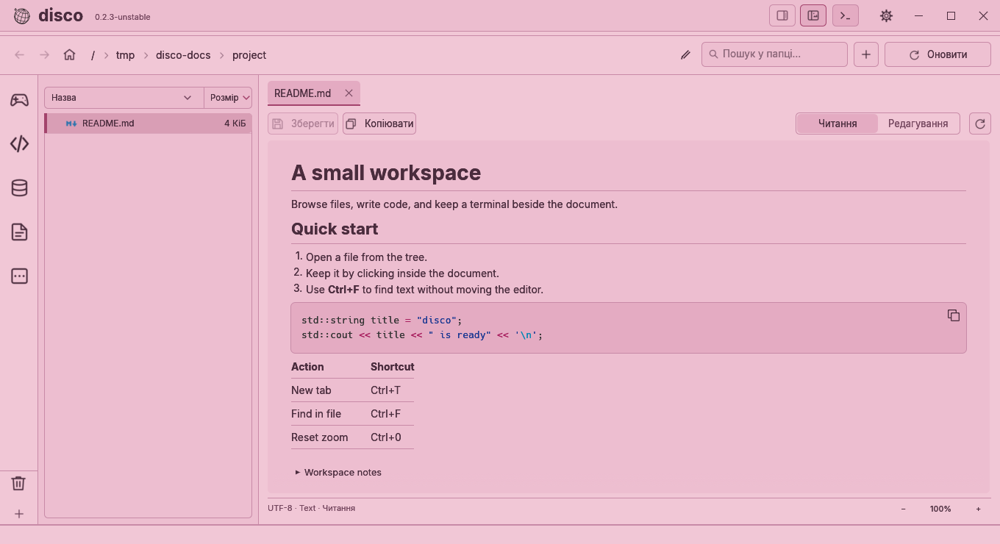

</details>

### Мови, іконки й незалежні масштаби

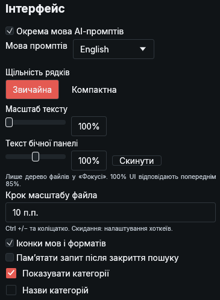

AI-промпти типово збігаються з мовою застосунка. Галочка **Окрема мова AI-промптів** відкриває незалежний вибір української/англійської для промптів категорій і тем. Промпт робота — текст для копіювання; disco сам не надсилає його AI-сервісу.

**Масштаб тексту** змінює інтерфейс; нові 100% відповідають старим 85%. **Масштаб тексту бічної панелі** окремо змінює дерево Фокуса від 80 до 120%; відступ вкладеності — 8 px. Масштаб документа незалежний.

Увімкни **Іконки мов і форматів** для 59 груп, включно з C/C++, Rust, JS/TS, JSON/YAML/TOML. Підтримуються Dockerfile, Makefile й типові dotfiles. Невідомі файли та зображення зберігають загальні символи. Типово опція вимкнена; завантажень іконок немає.

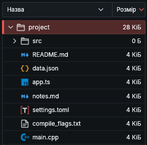

### Гарячі клавіші

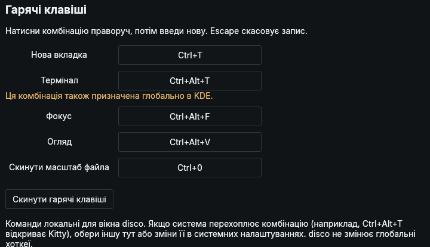

Клікни поле в Гарячих клавішах, затисни модифікатори й натисни основну клавішу. **Сам Ctrl+Alt не завершує запис.** Працюють комбінації Ctrl/Alt/Shift. Escape скасовує запис; Скинути повертає типові. Конфлікти та глобальні призначення KDE позначаються. Система може перехопити комбінацію до disco; застосунок не змінює системні призначення.

## Категорії, живі папки й Кошик

Налаштування → Категорії створює колекції з абсолютними шляхами та вбудованими/імпортованими іконками. Правий клік додає вибрані папки. Перетягування змінює порядок, **Закріпити порядок категорій** забороняє рух. Видалення категорії/шляху не видаляє файли. Промпт робота описує схему категорії й допомагає асистенту підібрати папки.

**Живе оновлення файлів** для категорії стежить за активною областю папок. Типово вимкнене й не залежить від оновлення активного документа. Зміни перечитують відповідні каталоги; помилки доступу/спостереження видно в статусі. Постійної служби індексації немає. Колекції можуть перетинатися; вкладені корені рахуються один раз.

Меню **···** унизу ліворуч відкриває великі файли, очищення й дублікати. Delete запитує перед переміщенням у **Кошик**. Є Відновити, остаточне видалення вибраного та Очищення; остаточне видалення потребує окремого підтвердження. Оновлення Кошика перечитує лише його й вільне місце, не замінюючи знімок папок.

## Конфігурація й межі

| Шлях у звичайному профілі | Призначення |
| --- | --- |
| `~/.config/disco/layout.toml` | Мова, вигляд, масштаби, клавіші |
| `~/.config/disco/themes.toml`, `themes/<id>.toml` | Каталог/активна тема та окремі кольори |
| `~/.config/disco/categories.toml`, `categories/*.toml` | Каталог та окремі колекції |
| `~/.config/disco/lsp.toml` | Каталог мовних серверів |
| `~/.cache/disco/last-scan.bin.gz` | Останній робочий каталог для запуску/сумісності |
| `~/.cache/disco/scans/<root-hash>/` | Окремі знімки та метадані коренів |

Підтримуються `XDG_CONFIG_HOME` / `XDG_CACHE_HOME`. Установка з `--config-dir ~/.config/disco-unstable` використовує **окремий профіль/кеш**; застосунок усе одно називається disco. Інший профіль не означає видалені дані. Приклади: [каталог тем](../assets/themes.toml), [кольори](../assets/themes/paper.toml), [схема категорій](../categories.example.toml). Старий `theme.toml` лишається резервною копією міграції. При поширенні категорій зберігай імпортовані `icons/`.

Текст: UTF-8 або UTF-16 із BOM, до **128 KiB / 2 000 рядків**; обрізані фрагменти лише для читання. Зображення: PNG/JPEG/WebP/BMP/TIFF, до **32 MiB / 12 мегапікселів**, збережений перегляд до 2048 px. Непідтримуваний вміст пояснює обмеження. Сканування рахує виділені блоки, не переходить на іншу файлову систему й не йде за symlink. Сумісність термінала залежить від програми.

## Швидкі клавіші

| Клавіші | Дія |
| --- | --- |
| ↑ / ↓, Home / End, Page Up / Down | Навігація списком файлів |
| → / ←, Enter | Розгорнути/згорнути; закріпити/сфокусувати перегляд; увійти в папку |
| Ctrl+T / Ctrl+N / Ctrl+S | Безіменна вкладка / створити файл / зберегти |
| Ctrl+W | Безпечно закрити активну вкладку |
| Ctrl+Tab / Ctrl+Shift+Tab | Наступна / попередня видима вкладка |
| Ctrl+L | Редагувати адресу |
| Ctrl+F, F3 / Shift+F3 | Пошук у Фокусі; наступний/попередній збіг |
| Ctrl+Plus / Minus, Ctrl+коліщатко, Ctrl+0 | Масштаб файла / скидання |
| Ctrl+Space / Ctrl+Shift+Space | Підказки / довідка про параметри |
| Alt+← / → у панелі сигнатур | Перегляд перевантажень |
| Ctrl+Alt+F / V / T | Типові Фокус / Огляд / Термінал |
| Ctrl+Alt+стрілки, F6 / Shift+F6 | Перемістити фокус між панелями |
| F5 / Alt+Home / Ctrl+, | Оновити / налаштований Home / Налаштування |
| Ctrl+Shift+C / V у терміналі | Копіювати / вставити |

Скріни — нативний інтерфейс 0.2.3-unstable з демонстраційними даними на приватному віртуальному дисплеї. [Docker-збірка](docker.uk.md) · [Розробка](development.md) · [Зміни](../CHANGELOG.md).
