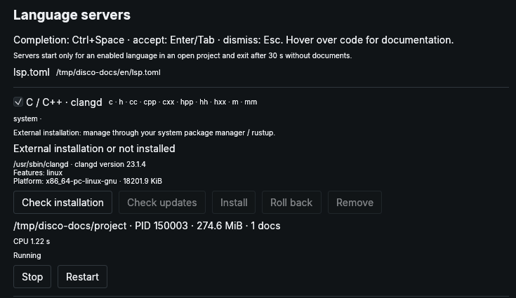
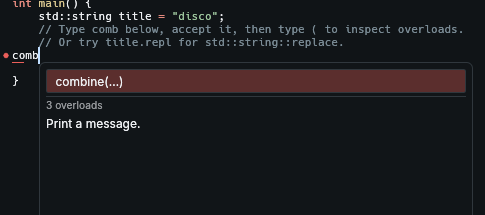
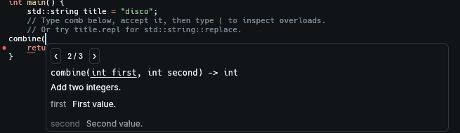
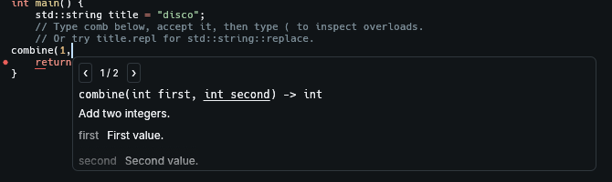

# Code completion and language servers

[User guide](guide.md) · **English** / [Українська](language-servers.uk.md)

For **0.2.3-unstable**. Syntax colors work without a server. Completion, signatures, documentation and diagnostics require an enabled language server; no AI account is needed.

## Set up a language

1. Open **Settings → Language servers** (`Ctrl+,`). All languages start disabled.
2. Install the server or select an existing installation as described below.
3. Check the language and **Save**. Installing alone does not enable it.
4. Open a saved source file with the matching extension. Allow the server to initialize, then try `Ctrl+Space` inside a function.



| Language | Bundled entry | What you need |
| --- | --- | --- |
| C / C++ | clangd | Install `clangd` through your system package manager; `clangd --version` must work. Also install your compiler and its standard-library headers. |
| Rust | rust-analyzer | Use **Install** for the managed binary. The Rust toolchain and project dependencies are separate. |
| Python | Pyright | Node.js and npm; click **Install**. The project’s Python environment is separate. |
| JavaScript / TypeScript | typescript-language-server | Node.js and npm; **Install** includes the catalog’s TypeScript dependency. Install your project dependencies separately. |

Managed downloads also require `curl` and `sha256sum`. Errors appear in this page. **Stop** suspends that session until Restart, re-enabling the server, or restarting disco. Files in the same project share a server; it exits 30 seconds after its last document closes. Untitled tabs connect after their first save with a supported extension.

## C++: tell clangd how to build the project

The filename is **`compile_commands.json`**, not `compile.commands.json`. It describes include paths, compiler flags and the C++ standard for each source file.

For a CMake project, configure it from its root:

```sh
cmake -S . -B build -DCMAKE_EXPORT_COMPILE_COMMANDS=ON
```

clangd searches parent directories and their `build/` subdirectories. A database elsewhere needs a link/copy in the source root or an explicit clangd configuration. For a small project with shared flags, a root-level `compile_flags.txt` is enough, with one flag per line:

```text
-std=c++20
-Iinclude
```

Use paths and flags from your actual build. `compile_commands.json` takes precedence when both files exist. See [clangd’s project setup guide](https://clangd.llvm.org/installation#project-setup).

### Try the included example

From the disco checkout, after enabling clangd:

```sh
disco docs/examples/lsp/main.cpp
```

The [example](examples/lsp/main.cpp) includes `compile_flags.txt`, three documented `combine` overloads and a `std::string`. Type on the blank line inside `main()`; no scan or build is needed to try completion. The C++ standard-library headers must still be installed.

## Two panels, two different actions

### 1. Choose a name: the completion list

Type `comb` or `title.repl`, or press **Ctrl+Space**. Two identifier characters, `.`, `::` and `->` trigger suggestions after a short pause.



**↑ / ↓** selects; **Enter / Tab** inserts; **Escape** closes. Documentation below the list belongs to the selected item. clangd groups overloads into one entry. **“3 overloads” is a count, not a switcher: Alt+arrows do not cycle signatures in this list.**

### 2. Inspect the call: parameter help

Accept `combine`, then type **`(`**. With the cursor inside the call, **Ctrl+Shift+Space** opens the same panel manually.



Use **‹ / ›** or **Alt+← / Alt+→** to inspect signatures. Ordinary arrows move the cursor. Type `1,` to see the current argument highlighted:



clangd can narrow the available signatures as you enter arguments. Inspecting another signature does not change the code or force the compiler to choose it. Escape dismisses the panel. Both panels float above the document without moving its text.

Descriptions come from the server, usually source/header comments; they may be incomplete or absent. disco presents common Doxygen tags as readable descriptions and parameter rows. It does not fetch documentation pages or generate AI explanations. Hover over code or diagnostic markers for additional information; the document status shows the diagnostic count.

## If suggestions do not appear

| Check | Action |
| --- | --- |
| Language enabled? | Check its box and **Save**; an installed server may still be disabled. |
| Saved file? | Save an untitled tab with a supported extension, e.g. `.cpp`. Use `.cpp` for `std::`; a `.c` file is C. |
| Server running? | Check errors and session status in Language servers; use **Restart** if stopped. |
| Cursor in code? | Focus the editor, put the cursor inside a function and press `Ctrl+Space`. A focused terminal receives its own keys. |
| Missing includes or wrong flags? | Check compiler/standard-library installation and the build database. A missing database uses fallback flags. |
| No signature arrows? | Accept the name and type `(` first; keep the cursor inside the call. |
| No description? | The server may not provide one. This is separate from whether completion works. |

## Installation management and custom servers

**Check updates** explicitly checks GitHub/npm; **Update** installs the offered version. Managed downloads are verified before switching. Failed/cancelled installs keep the working version. **Roll back** selects the previous managed version; **Remove** deletes disco-managed files only. System/rustup installations are managed externally. Package actions happen immediately; Save/Cancel applies to language checkboxes.

The catalog path appears in Settings: normally `~/.config/disco/lsp.toml`, or `~/.config/disco-unstable/lsp.toml` for an isolated development launcher. Close disco before editing it, then restart. Project-local disco `lsp.toml` files are not loaded. See the complete [bundled catalog](../assets/lsp.toml).

<details>
<summary>Catalog fields and storage</summary>

`version = 1`. Each `[servers.ID]` specifies `name`, `enabled`, matching `extensions` / `languages` arrays, `command`, `args` and `root_markers`. The nearest ancestor with a marker is the project root; otherwise the file’s parent is used.

| Provider | Additional fields |
| --- | --- |
| `system` | Existing executable name or absolute executable path |
| `rustup` | `version` (default `stable`); runs `rustup run VERSION COMMAND` |
| `github_release` | `repository`, pinned `version`, exact gzip `asset`, `sha256`, `platform` |
| `npm` | `package`, pinned `version`, SHA-512 `integrity`, optional pinned `extra_packages` |

Managed packages live in `$XDG_DATA_HOME/disco/lsp` (normally `~/.local/share/disco/lsp`). Version metadata supports verification and rollback. Up to four project sessions run concurrently. Managed size includes dependencies; external probes report executable size.

</details>

## Current scope

Supported: plain-text completion with additional edits, lazy completion documentation, hover, signature help and push diagnostics. Accepting a suggestion is one undoable edit; it does not itself save the file. Existing auto-save rules still apply.

Not implemented: snippets, go-to-definition, rename, formatting, code actions, workspace edits, semantic tokens, debugger or integrated AI completion. The editor’s 128 KiB / 2,000-line limits still apply. clangd’s background index and clang-tidy are disabled by default; Rust build scripts, proc macros and check-on-save are disabled by default. Versionless server diagnostics cannot provide the same stale-result guarantees as versioned messages.

Developer details and resource measurements: [LSP investigation](investigations/lsp-resources.md). Screenshots show native 0.2.3-unstable UI with the included example, captured on a private virtual display.
