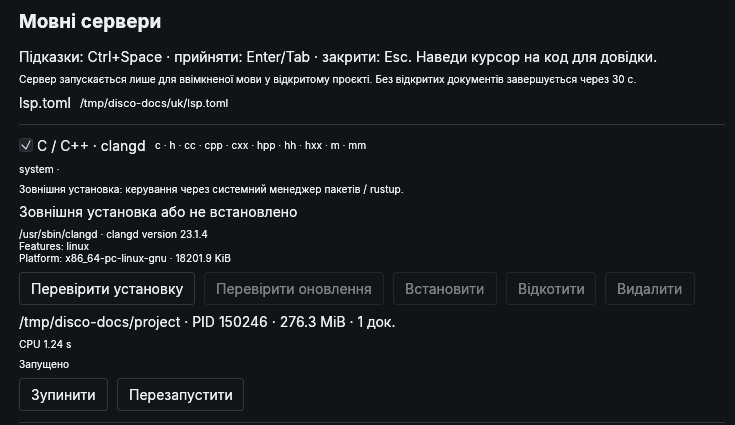
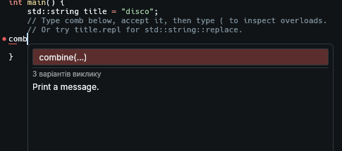
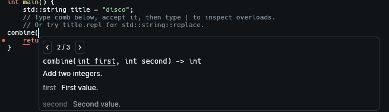
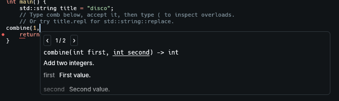

# Підказки коду та мовні сервери

[Посібник](guide.uk.md) · [English](language-servers.md) / **Українська**

Для **0.2.3-unstable**. Кольори синтаксису працюють без сервера. Для підказок, сигнатур, документації та діагностики потрібно ввімкнути мовний сервер. Обліковий запис AI не потрібен.

## Налаштувати мову

1. Відкрий **Налаштування → Мовні сервери** (`Ctrl+,`). Спочатку всі мови вимкнені.
2. Установи сервер або використай наявну установку за таблицею нижче.
3. Постав галочку біля мови й натисни **Зберегти**. Саме встановлення не вмикає сервер.
4. Відкрий збережений файл із відповідним розширенням. Дочекайся запуску сервера й спробуй `Ctrl+Space` усередині функції.



| Мова | Сервер у каталозі | Що потрібно |
| --- | --- | --- |
| C / C++ | clangd | Установи `clangd` системним менеджером пакетів; `clangd --version` має працювати. Також потрібні компілятор і заголовки стандартної бібліотеки. |
| Rust | rust-analyzer | Кнопка **Встановити** завантажує власний бінарник. Rust toolchain і залежності проєкту встановлюються окремо. |
| Python | Pyright | Node.js і npm; натисни **Встановити**. Python-середовище проєкту налаштовується окремо. |
| JavaScript / TypeScript | typescript-language-server | Node.js і npm; **Встановити** також додає TypeScript із каталогу. Залежності проєкту встановлюються окремо. |

Для керованих завантажень також потрібні `curl` і `sha256sum`. Помилки видно на цій сторінці. **Зупинити** призупиняє сесію до перезапуску сервера, повторного ввімкнення чи перезапуску disco. Файли одного проєкту використовують спільний сервер; через 30 секунд після закриття останнього документа він завершується. Безіменна вкладка підключається після першого збереження з відомим розширенням.

## C++: пояснити clangd, як збирається проєкт

Правильна назва — **`compile_commands.json`**, не `compile.commands.json`. У ньому записані шляхи до заголовків, параметри компілятора та стандарт C++ для кожного файла.

Для CMake-проєкту виконай із його кореня:

```sh
cmake -S . -B build -DCMAKE_EXPORT_COMPILE_COMMANDS=ON
```

clangd шукає базу в батьківських папках і їхніх підпапках `build/`. Якщо вона лежить деінде, потрібне посилання/копія в корені джерел або явне налаштування clangd. Для маленького проєкту зі спільними прапорцями достатньо `compile_flags.txt` у корені — один параметр на рядок:

```text
-std=c++20
-Iinclude
```

Укажи прапорці й шляхи своєї збірки. Якщо є обидва файли, використовується `compile_commands.json`. Докладніше: [налаштування проєкту в clangd](https://clangd.llvm.org/installation#project-setup).

### Спробувати готовий приклад

Із папки репозиторію disco, після ввімкнення clangd:

```sh
disco docs/examples/lsp/main.cpp
```

У [прикладі](examples/lsp/main.cpp) вже є `compile_flags.txt`, три документовані варіанти `combine` і `std::string`. Пиши на порожньому рядку всередині `main()`. Для перевірки підказок не потрібні сканування чи збірка; заголовки стандартної бібліотеки C++ усе одно мають бути встановлені.

## Дві панелі — дві різні дії

### 1. Обрати назву: список підказок

Напиши `comb` або `title.repl` чи натисни **Ctrl+Space**. Два символи назви, `.`, `::` та `->` викликають підказки після короткої паузи.



**↑ / ↓** обирають; **Enter / Tab** вставляють; **Escape** закриває. Опис унизу стосується вибраного пункту. clangd об’єднує перевантаження в один пункт. **«3 варіантів виклику» — це кількість, а не перемикач: Alt зі стрілками в цьому списку не перебирає сигнатури.**

### 2. Переглянути виклик: довідка про параметри

Прийми `combine`, потім напиши **`(`**. Якщо курсор усередині виклику, **Ctrl+Shift+Space** відкриє цю панель вручну.



Перемикай сигнатури кнопками **‹ / ›** або **Alt+← / Alt+→**. Звичайні стрілки рухають курсор. Напиши `1,`, щоб побачити виділення поточного аргументу:



clangd може звужувати список відповідно до введених аргументів. Перегляд іншої сигнатури не змінює код і не примушує компілятор обрати її. Escape закриває панель. Обидві панелі плавають над документом і не зсувають текст.

Описи надходять від сервера, зазвичай із коментарів коду/заголовків; вони можуть бути неповними або відсутніми. disco показує типові Doxygen-теги як читабельний опис і рядки параметрів. Він не завантажує вебсторінки документації й не генерує AI-пояснення. Наведи курсор на код або позначку діагностики для додаткових відомостей; кількість діагностик видно внизу документа.

## Перехід до визначення

Постав курсор на символ і натисни **F12** або зроби **Ctrl+клік**. Ціль відкриється закріпленою вкладкою Фокуса на позиції, яку повернув сервер; інші чернетки залишаються відкритими. Сканування не запускається. Для кількох результатів є вибір (↑/↓, Enter або клік; Escape закриває). Відсутність результату показується в статусі.

Результат залежить від сервера, налаштувань та індексу проєкту. Зокрема background index clangd типово вимкнений: реалізація в іншому невідкритому файлі може бути недоступна, а сервер може повернути оголошення. Це окремий механізм від переходу до діагностик.

## Якщо підказок немає

| Перевірка | Що зробити |
| --- | --- |
| Мова ввімкнена? | Постав галочку й натисни **Зберегти**; установлений сервер може бути вимкнений. |
| Файл збережений? | Збережи безіменну вкладку з потрібним розширенням, наприклад `.cpp`. Для `std::` потрібен C++; `.c` — це C. |
| Сервер працює? | Переглянь помилки й стан сесії в налаштуваннях. Якщо зупинений — **Перезапустити**. |
| Курсор у коді? | Сфокусуй редактор, постав курсор усередині функції та натисни `Ctrl+Space`. Сфокусований термінал отримує власні клавіші. |
| Немає заголовків чи неправильні прапорці? | Перевір компілятор, стандартну бібліотеку та базу команд збірки. Без бази сервер використовує запасні параметри. |
| Немає стрілок сигнатур? | Спочатку прийми назву й напиши `(`. Курсор має залишатися всередині виклику. |
| Немає опису? | Сервер може його не надати, навіть якщо самі підказки працюють. |

## Керування установками й власні сервери

**Перевірити оновлення** явно звертається до GitHub/npm; **Оновити** встановлює запропоновану версію. Завантаження перевіряється до перемикання. Збій чи скасування зберігає робочу версію. **Відкотити** повертає попередню власну версію; **Видалити** прибирає лише файли, установлені disco. Системні/rustup-установки керуються зовні. Дії з пакетами виконуються одразу; Зберегти/Скасувати стосуються галочок мов.

Шлях до каталогу показаний у налаштуваннях: зазвичай `~/.config/disco/lsp.toml`, для ізольованого development-лаунчера — `~/.config/disco-unstable/lsp.toml`. Редагуй із закритим disco та перезапусти. Проєктні файли disco `lsp.toml` не завантажуються. Повний [каталог-приклад](../assets/lsp.toml).

<details>
<summary>Поля каталогу та сховище</summary>

`version = 1`. Кожен `[servers.ID]` містить `name`, `enabled`, відповідні масиви `extensions` / `languages`, `command`, `args` і `root_markers`. Корінь проєкту — найближчий предок із маркером; інакше батьківська папка файла.

| Провайдер | Додаткові поля |
| --- | --- |
| `system` | Назва наявного виконуваного файла або абсолютний шлях |
| `rustup` | `version` (типово `stable`); виконує `rustup run VERSION COMMAND` |
| `github_release` | `repository`, зафіксована `version`, точний gzip `asset`, `sha256`, `platform` |
| `npm` | `package`, зафіксована `version`, SHA-512 `integrity`, необов’язкові зафіксовані `extra_packages` |

Власні пакети: `$XDG_DATA_HOME/disco/lsp` (типово `~/.local/share/disco/lsp`). Метадані версій потрібні для перевірки й відкату. Одночасно працюють до чотирьох проєктних сесій. Розмір власної установки враховує залежності, зовнішньої — виконуваний файл.

</details>

## Поточні межі

Працюють текстові підказки з додатковими правками, довантаження документації, hover, сигнатури й push-діагностика. Прийняття підказки — одна дія Undo; саме по собі воно не зберігає файл. Наявні правила автозбереження діють окремо.

Ще не реалізовані snippets, перейменування символів, форматування, code actions, workspace edits, semantic tokens, debugger чи вбудоване AI-доповнення. Зберігається ліміт редактора 128 KiB / 2 000 рядків. Типово в clangd вимкнені background index і clang-tidy; у Rust — build scripts, proc macros та check-on-save. Діагностики без версії від сервера не мають таких самих гарантій актуальності, як версійовані повідомлення.

Технічні подробиці та заміри ресурсів: [дослідження LSP](investigations/lsp-resources.md). Скріни — нативний інтерфейс 0.2.3-unstable із готовим прикладом, знятий на приватному віртуальному дисплеї.
